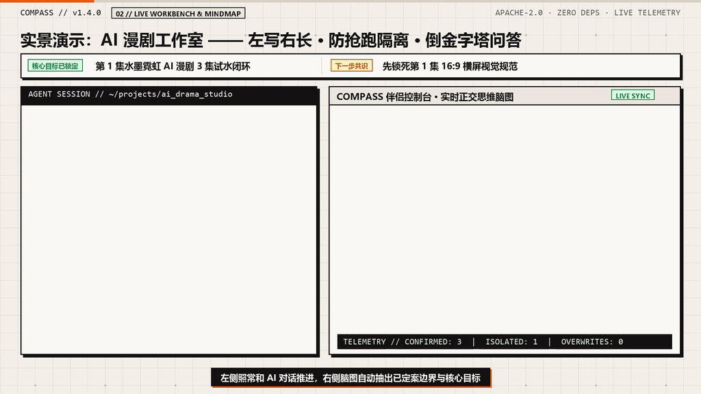
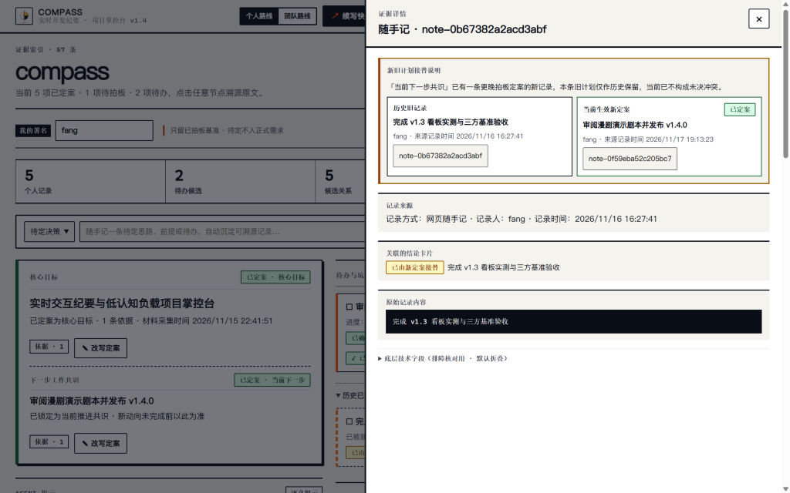

<p align="center">
  <picture>
    <source media="(prefers-color-scheme: dark)" srcset="docs/images/compass_style2_master_dark.svg">
    <source media="(prefers-color-scheme: light)" srcset="docs/images/compass_style2_master_light.svg">
    
  </picture>
</p>

<p align="center">
  <strong>Compass v1.7.1 · 和 AI 一起做项目，不怕聊着聊着忘了目标和决定</strong><br>
  左边正常和 Coding Agent 对话写代码，右边实时长出「目标、当前下一步、待选方案对比和避坑记录」。<br>
  100% 纯本地运行（<code>dependencies = []</code>），对话与决策账本只保存在你自己电脑的 <code>.project-memory/</code>。
</p>

<p align="center">
  <a href="README_EN.md">English</a> • <a href="README.md">简体中文</a> • <a href="docs/PRODUCT_SPEC.md">产品规格</a> • <a href="docs/INDEX.md">文档索引</a>
</p>

<p align="center">
  <a href="LICENSE"></a>
  <a href="pyproject.toml"></a>
  <a href="pyproject.toml"></a>
  <a href="pyproject.toml"></a>
  <a href="server.json"></a>
  <a href="tests/"></a>
</p>

<p align="center">
  
</p>
<p align="center">
  <em>左边照常聊天改代码，右边自动长出思维导图与决策台账；待确认想法自动隔离，确认后的决定一键发给 AI 执行。</em>
</p>

---

## ⚡ 30 秒先看效果（零配置，不改你的任何代码）

装好 Python 3.10+ 即可用内置示范项目（**「个人播客笔记与剪藏小工具」**）直接打开可视化看板体验：

```bash
# 方式 A：免预装直接体验（推荐，需要 uv）
uvx --from git+https://github.com/f22363712-dotcom/compass compass --demo

# 方式 B：克隆源码运行
git clone https://github.com/f22363712-dotcom/compass.git
cd compass && pip install -e .
compass --demo
```

运行后会自动打开浏览器看板，你可以直接点选思维导图节点、点击 **「✓ 标记已完成」** 或 **「✓ 确认并发给 AI」**、用全文搜索框直接提问「下一步做什么」。

---

## 💬 懒人一键配置：复制下面这段话发给你的 AI 助手

如果不想记命令，直接在 **Antigravity / Cursor / Claude Code / Codex CLI** 中对你的 AI 助手发送下面这段话，它会帮你完成全部配置并自检：

> 请帮我把当前项目接入 Compass 看板：
> 1. 先检查本机是否已有 `compass-mcp`；如果没有，用 `pip install -e .` 或 `uvx` 配好零依赖环境；
> 2. 在当前项目根目录运行 `compass-setup --project-path . --init-rules`（写入规则并自动把 `.project-memory/` 加进 `.gitignore`）；
> 3. 执行 `compass-setup --client <填你用的工具: antigravity/cursor/claude/codex/hermes> --project-path . --zero-config --write`；
> 4. 运行 `compass-setup --doctor --project-path .` 确认检查全部通过后告诉我。

---

## 🤔 Compass 解决什么问题？

和 Coding Agent 聊久了做项目，最容易遇到四件事：

| 你经常遇到的抓狂时刻 | 以前 | 用了 **Compass v1.7.1** 之后 |
| :--- | :--- | :--- |
| **随口提个备选思路，AI 当圣旨直接改代码** | 对话和代码混在一起，AI 抢跑实现未决方案 | 新想法自动放进「待确认想法」，你点确认或勾选「同时标记为已确认」才算正式生效 |
| **聊到第 20 轮忘了主目标和当前重点** | 目标被几十轮日志和报错淹没，新开窗口就失忆 | 顶部永久固定 **核心目标** + **当前下一步**，做完还能点 **「✓ 标记已完成」** |
| **之前否决过的方案过两天 AI 又提一遍** | 找不到当时为什么排除，白白返工踩坑 | 明确排除的路线和未核实前提保留原话依据，AI 偏航或重提旧坑会主动提醒 |
| **跨项目 / 多个窗口开着容易记串** | 全局配置不知道写去了哪 | 每个项目独立存进自己的 `.project-memory/`，支持点击卡片或 `open_compass` 随时核对 |

---

## 🚀 3 分钟手动接入你自己的项目

支持 Python >= 3.10，核心包**零第三方依赖**（`dependencies = []`）。

### 1. 安装（二选一）

```bash
git clone https://github.com/f22363712-dotcom/compass.git
cd compass
pip install -e .
```

### 2. 初始化规则 + 写入宿主零配置（必加 `--zero-config`）

进入你要开发的项目根目录：

```bash
# 1. 写入项目协作守则，并自动把 .project-memory/ 加入 .gitignore 防误提交
compass-setup --project-path . --init-rules

# 2. 按你使用的工具写入 MCP 零配置（任选一条）
compass-setup --client antigravity --project-path . --zero-config --write
compass-setup --client cursor      --project-path . --zero-config --write
compass-setup --client claude      --project-path . --zero-config --write
compass-setup --client codex       --project-path . --zero-config --write
compass-setup --client hermes      --project-path . --zero-config --write

# 3. 跑一次环境自检
compass-setup --doctor --project-path .
```

### 3. 日常怎么用最顺手？

- **在 Antigravity 里**：上面 `--write` 已顺带装好原生右侧栏插件；聊天时在需要的时机调用 `open_compass` 或点击对话里的 `[打开 Compass 实时掌控台](sidecar://compass/compass_board/)` 胶囊，即可在右侧并排查看，切换左侧工程时右侧会自动同步。
- **在 Cursor / Codex / Claude / 独立浏览器里**：随时在项目目录执行一条命令把看板开在屏幕右半边（`540px–720px` 窄分屏适配）：

```bash
compass --open . --extract-docs --with-code-index --web --port 8787
```

<details>
<summary>查看手动 mcp.json 写法 &amp; 8 项 MCP 工具说明</summary>

```json
{
  "mcpServers": {
    "project-compass": {
      "type": "stdio",
      "command": "compass-mcp",
      "args": ["--project-path", "."]
    }
  }
}
```

（若未全局安装，可把 `"command"` 改为 `"uvx"`，`"args"` 为 `["--from", "git+https://github.com/f22363712-dotcom/compass", "compass-mcp", "--project-path", "."]`。）

内置 8 个 MCP 工具：
1. `project_context`：开局或长对话压缩后对齐核心目标、当前下一步、优先执行列表与待确认想法。
2. `record_note`：随时用一句话记下新想法、前提假设、待办或目标（支持 `15~20` 字短标题）。
3. `verify_completion`：Agent 声称完工前核查改动记录、测试退出码与未清待办，并在提醒中附上可直达看板入口。
4. `append_evidence`：追加公开会话纪要与可核对的命令执行结果。
5. `query_state`：按关键词或自然问题检索项目事实、分歧与证据原文。
6. `propose_fact`：提交带原文引用的结构化提案（未经人确认保持 `proposed`）。
7. `open_compass`：按宿主环境自动识别侧栏 / IDE 内置浏览器 / 本机浏览器打开主看板。
8. `compass_app_action`：供内嵌 MCP App 面板执行确认、忽略、撤回、记一条与发送给 AI。

</details>

---

## 📸 界面与核心功能一览

<p align="center">
  
</p>
<p align="center">
  <em>图 1：主工作台 —— 顶部支持「个人模式 / 团队协作模式」与可插拔 AI 模式切换，下方默认展开思维导图生长视图</em>
</p>

<table align="center">
  <tr>
    <td width="42%" align="center" valign="top">
      
      <br><sub><em>图 2：窄分屏视图（680×880）—— 无横向滚动条，适合贴靠 IDE 左侧对话窗口常驻</em></sub>
    </td>
    <td width="58%" align="center" valign="top">
      
      <br><sub><em>图 3：问答与进度摘要 —— 先给近期已完成与当前下一步，再附对应原文依据</em></sub>
    </td>
  </tr>
</table>

<p align="center">
  
</p>
<p align="center">
  <em>图 4：新旧接替与分歧对照 —— 点开任意条目即可并列查看历史原话与变更原因</em>
</p>

<details>
<summary>展开更多界面截图：悬停原文气泡 &amp; 上下文续写简报导出</summary>

<p align="center">
  
</p>
<p align="center">
  
</p>

</details>

---

## 🧠 可选增强：接入你自己的 AI 模型（默认纯本地也能用）

Compass **不配置任何 API Key 也能完成 100% 核心功能（本地检索与规则提醒）**。如需启用更聪明的 AI 归纳与提醒，在终端或 `.env` 中设置任意一路环境变量即可：

```bash
export MINIMAX_API_KEY="your-minimax-key"      # MiniMax-M3.1-Flash / MiniMax-M2.7
export DEEPSEEK_API_KEY="your-deepseek-key"    # DeepSeek-Chat
export OLLAMA_HOST="http://127.0.0.1:11434"    # 本机 Ollama 模型
```

<details>
<summary>查看 v1.4 四路同题评测基准数据与真实对比说明</summary>

详细复盘、延迟采样与真实失效归因见：[v1.4 评测与定版报告](docs/COMPASS_V1_4_MODEL_BENCHMARK_AND_UX_SEAL_2026-11-16.md)。

| 对照路线 | 综合得分 | 关键事实抽取 (L2 F1 / Recall) | 回答准确率 (14 题) | 证据引用有效率 | 适用定位与说明 |
| :--- | :---: | :---: | :---: | :---: | :--- |
| **纯本地检索 (`v1.3` 基线)** | 39.8 / 100 | F1 `0.0909` | 35.71% (5/14) | **100%** | 零外网依赖、零成本，完全可保底运行 |
| **`MiniMax-M3.1-Flash`** *(推荐默认)* | 41.3 / 100 | **F1 `0.1525`** | 42.86% (6/14) | **100% (14/14)** | 单问延迟 `~2.55s–3.2s`，兼顾零幻觉引文与速度 |
| **`MiniMax-M2.7`** | 41.1 / 100 | F1 `0.1440` | **50.00% (7/14)** | **100%** | 适合复杂深问分析 |
| **`DeepSeek-Chat`** | **41.8 / 100** | Recall **`63.16%`** (12/19) | 28.57% (4/14) | 92.86% | 事实覆盖高，单问 `~1.79s` |

</details>

---

## 🧪 运行全套自检与测试

```bash
# Python 单元测试（PowerShell）
$env:PYTHONPATH = 'src'; python -m unittest discover -s tests -q

# 前端 JS 契约测试（需本机安装 Node.js）
node --check src/project_compass/web/app.js
for f in tests/*_test.cjs; do node "$f" src/project_compass/web/app.js; done
```

---

## 📄 开源许可与致谢

本项目基于 **[Apache License 2.0](LICENSE)** 开源发布。第三方组件与适配说明见 [THIRD_PARTY_NOTICES.md](THIRD_PARTY_NOTICES.md) 与 [licenses/learn-ai-basics-MIT.txt](licenses/learn-ai-basics-MIT.txt)。
