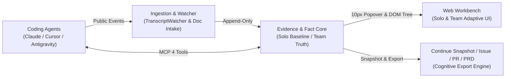

<p align="center">
  <picture>
    <source media="(prefers-color-scheme: dark)" srcset="docs/images/compass_style2_master_dark.svg">
    <source media="(prefers-color-scheme: light)" srcset="docs/images/compass_style2_master_light.svg">
    
  </picture>
</p>

<p align="center">
  <strong>Compass · Real-Time AI Development Notes &amp; Truth Workbench (v1.0)</strong><br>
  人与 AI 结对开发的实时会议交互助手与项目掌控台 —— 让每一次行动、待定思路与已定案基准透明可见。
</p>

<p align="center">
  <a href="README_EN.md">English</a> • <a href="README.md">简体中文</a> • <a href="docs/PRODUCT_GOAL.md">产品目标</a> • <a href="docs/INDEX.md">文档总索引</a>
</p>

<p align="center">
  <a href="LICENSE"></a>
  <a href="tests/"></a>
  <a href="pyproject.toml"></a>
  <a href="docs/INDEX.md"></a>
  <a href="THIRD_PARTY_NOTICES.md"></a>
  <a href="https://modelcontextprotocol.io/"></a>
</p>

---

## ⚡ 为什么我们需要 Compass？

用 AI 写代码（Vibe Coding / Agent 结对开发）速度极快，但人很快就会失去对项目的掌控感：

* **传统 IDE Diff 太晦涩**：上百行代码改动与几十万字终端日志，对非科班或重度依赖 AI 开发的创作者而言认知负载极高，根本不想逐行翻阅。
* **思路被 Agent 抢跑或遗忘**：你只是在和 Agent 碰撞一个**待定想法**，还没拍板，Agent 就当成既定事实把架构改了；或者聊了几十轮之后，早先悬而未决的待定项被压缩遗漏。
* **长对话黑盒与跨窗口失忆**：前一天讨论清楚的思路散落在不同窗口或 CLI 会话里，隔天续写或团队交接时无从追溯“为什么当时定成这样”。

**Compass 把它做成“AI 开发过程的实时会议交互助手”**：
1. **实时开发纪要 + 待定/定案硬隔离**：就像开会旁听的交互白板，实时记录“刚做了什么 → 冒出哪些待定思路与未验证前提 → 哪些已拍板定案”，绝不让 AI 私自把猜测写成既定基准。
2. **个人优先 → 团队扩展（Solo / Team 双路线自由切换）**：单人开发者选**个人路线**，零多余团队审批仪式感，专注个人轨迹与一键定案；拉入协作者或开多 Agent 并行时切换**团队路线**，无缝展开多会话在场状态、分歧裁决矩阵与交接流转。
3. **10px 邻近预取与精准检索溯源**：无需 grep 原始日志，光标靠近任意 `[证据 ID]` 徽标 **10px** 范围即预取原文，悬停即时浮现原始发言、作者、时间与来源有效性（`● 当前有效`），提问即可精准检出原因与证据缺口。

---

## 🧭 两条路线，同一套可信账本

你可以在看板右上角随时切换自己的使用模式（单人工作区默认开启个人路线，检测到多成员协同时自动适配团队路线）：

| 维度 | 个人开发路线（Solo Mode） | 团队协作路线（Team Mode） |
| :--- | :--- | :--- |
| **核心体验** | 像个人 AI 会议交互助手，零团队审批仪式感 | 面向 2–4 人协同或并行多 Agent 开发的共识工作台 |
| **视角划分** | **实时纪要 · 待定思路** ↔ **项目基准 · 已定案** | **个人视图 · 个人看板** ↔ **团队共识 · 事实基准** |
| **拍板确认** | 在个人纪要或详情抽屉直接**一键定案为项目基准**，浏览器本地记住你的署名 | 展开多成员在场状态栏、并列立场分歧矩阵与负责人审核队列 |
| **快照导出** | 生成**个人上下文续写快照**，方便新开对话窗口续接 | 导出**项目交接简报**（GitHub Issue / PR / 结构化 PRD） |

---

## 📸 核心界面概览

<p align="center">
  
</p>
<p align="center">
  <em>图 1：Compass v1.0 Swiss Neo-Brutalism（5fr/7fr）掌控台 —— 支持顶栏「个人路线 / 团队路线」自由切换，左侧聚焦目标、追问与动态流，右侧呈现待定/定案台账或团队分歧裁决矩阵</em>
</p>

---

## 🎯 四大核心工程体验

### 1. 原文悬停透视与 10px 邻近预取 (Streaming Span Quoting)
不需要翻几十屏对话记录或 IDE diff。光标靠近任何证据徽标（例如 `[ev-auth-01]`）**10px 范围内**即触发后台预取，悬停或键盘焦点激活后快速浮现气泡，展示来源、时间戳与对齐的原始会话摘要。

<p align="center">
  
</p>

### 2. 深度 AST 拓扑穿透与代码关联理解 (AST Multi-hop Traversal)
用人话看懂 AI 动了哪里。Compass 纯标准库解析 Python AST，将 `决策 / 思路 ➔ 原始证据 ➔ 代码模块节点 ➔ 调用链路 (Caller/Callee)` 串成可读视图，直观标出关联结构与潜在影响范围。

### 3. 诚实校验与未验证前提拦截 (Explicit Gaps & Speculative Badges)
* **诚实留白原则**：尚无直接测试证据 ID 支撑的结论只标为 `✦ 校验标记（缺证据）`；
* **可溯源标记**：关联有可复查执行日志与退码的条目显示 `✦ 关联校验通过`，点击即可下钻至对应命令记录核对覆盖范围。

### 4. 一键定案与双向认知快照 (In-Card Triage & Context Snapshot)
无论是在个人路线下对自己的思路一键拍板定案，还是团队路线下裁决冲突立场，每次确认都以追加记录写入账本，推翻前的旧历史永久保留；同时支持导出为 Markdown 上下文快照、GitHub Issue、PR 描述或结构化 PRD。

<p align="center">
  
</p>

---

## ⚡ 3 秒接入（原生 MCP + 本地可视化看板）

纯 Python 标准库架构，**零外部运行时依赖（`dependencies = []`）**，原生兼容 **Model Context Protocol (MCP)**。

### 方式 1：作为 MCP 服务接入 Cursor / Claude Desktop / Windsurf
直接将以下配置写入 `.cursor/mcp.json` 或 `claude_desktop_config.json`：

```json
{
  "mcpServers": {
    "compass": {
      "command": "uvx",
      "args": [
        "--from",
        "git+https://github.com/f22363712-dotcom/compass",
        "compass-mcp",
        "--project-path",
        "."
      ]
    }
  }
}
```

也可以告诉你的 Agent：
> *“把 `git+https://github.com/f22363712-dotcom/compass` 作为 MCP 工具（`compass-mcp --project-path .`）接入当前项目，持续记录我的核心决策、待定思路和关键证据。”*

接入后 Agent 获得 **4 项原生工具**：
* `project_context`：读取当前已定案项目基准、确认事实与现存分歧边界。
* `append_evidence`：安全追加公开对话与可验证的命令执行记录。
* `query_state`：检索当前状态、待定分支、冲突立场及未补齐的证据缺口。
* `propose_fact`：向你的 Compass 工作台提交附带原文精确引用的事实或思路提议。

> 💡 **零配置本地模式 vs 远程 HTTP 模式**：  
> 不传 `--base-url` 时，`compass-mcp --project-path .` 直接读写当前目录下的 `.project-memory/` 工作区，无需任何环境变量；如连接共享团队 HTTP 服务，可附加 `--base-url http://127.0.0.1:8787` 并配置 `PROJECT_COMPASS_AGENT_TOKEN`。

---

### 方式 2：一行命令开启本地实时可视化看板

通过 `uvx` 免克隆直接运行：

```bash
# 扫描当前仓库（自动提取文档事实 + 生成 AST 代码结构索引）并启动网页看板
uvx --from git+https://github.com/f22363712-dotcom/compass compass --scan . --extract-docs --with-code-index --web

# 体验内置免配置仿真示例看板
uvx --from git+https://github.com/f22363712-dotcom/compass compass --sample --web
```

或克隆仓库进行本地源码安装与开发：

```bash
git clone https://github.com/f22363712-dotcom/compass.git
cd compass
pip install -e .

# 使用短命令打开当前项目或体验示例数据
compass --open . --extract-docs --with-code-index --web
compass --sample --web --port 8787

# 回放内部自举案例数据集
compass --input examples/dogfood_project_compass.json --export-format json
```

---

## 🧪 工程自律与自动化测试

Compass 坚持“所有结论都有源可溯，所有行为都有契约门禁”：

* **Python 单元测试 + Node VM 前端契约测试（零第三方运行时依赖）**：覆盖本地 `ThreadingHTTPServer` 状态机与审批闭环、流式精确引文校验、AST 跨模块多跳拓扑、Solo/Team 双路线渲染状态机、DOM 逃逸注入防护与崩溃恢复。
* **PBR (Perspective-Based Reading) 穿透式审查**：核心变更均需经由用户视角、架构数据流视角与对抗测试视角验证。
* **真凭实据原则**：绝不编造虚拟结论，绝不展示隐藏推理过程。详细文档见 [docs/INDEX.md](docs/INDEX.md)。

在仓库根目录运行全套验证：

```bash
# macOS / Linux
PYTHONPATH=src python3 -m unittest discover -s tests -q

# Windows (PowerShell)
$env:PYTHONPATH = 'src'; python -m unittest discover -s tests -q
```

---

## 🗺️ 架构与后续演进（Roadmap）



* **v1.0（已发布）**：Solo-First → Team 自适应双路线掌控台、只追加原始账本、10px 悬停溯源、AST 代码上下文、MCP 4 工具与双向导出。
* **vNext（演进方向 — 模型主动健康度巡检 Proactive Insights）**：在不越权篡改账本的前提下，让模型持续从实时事件与代码图谱中主动发现并发出三类“止血提醒”：
  1. 样式或交互开始零散、出现多套重复实现；
  2. 新改动正在基于一条**尚未验证的假设**推进；
  3. 冗余模块残留与跨模块隐性契约漂移。

---

## 📄 开源声明与第三方许可

本项目采用 **[Apache License 2.0](LICENSE)** 开源授权。第三方组件与适配许可说明详见 [THIRD_PARTY_NOTICES.md](THIRD_PARTY_NOTICES.md) 与 [licenses/learn-ai-basics-MIT.txt](licenses/learn-ai-basics-MIT.txt)。
