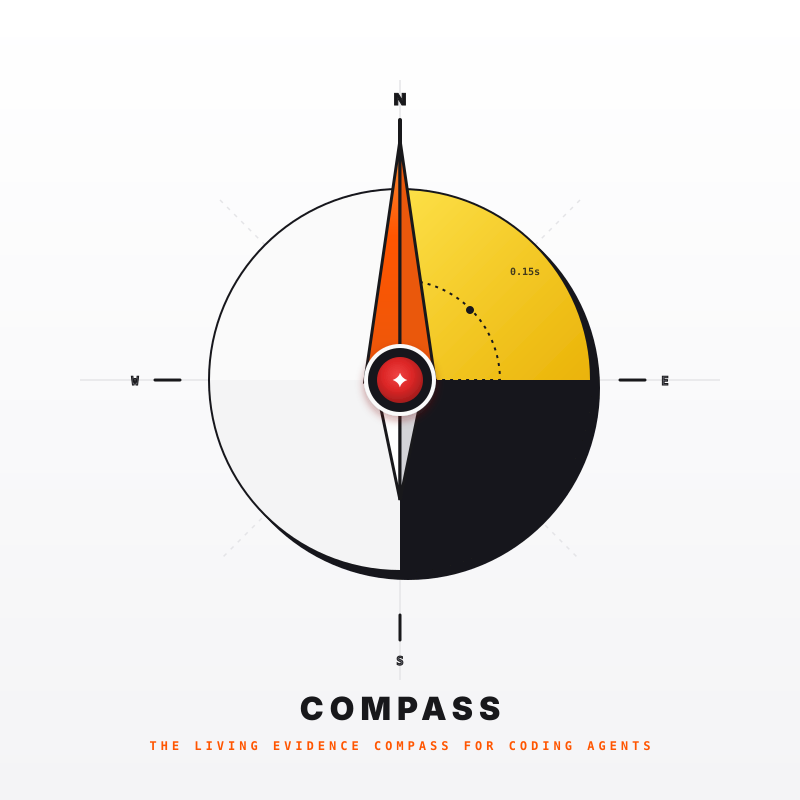
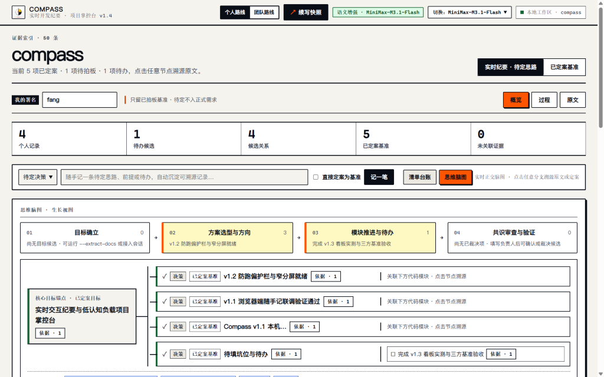
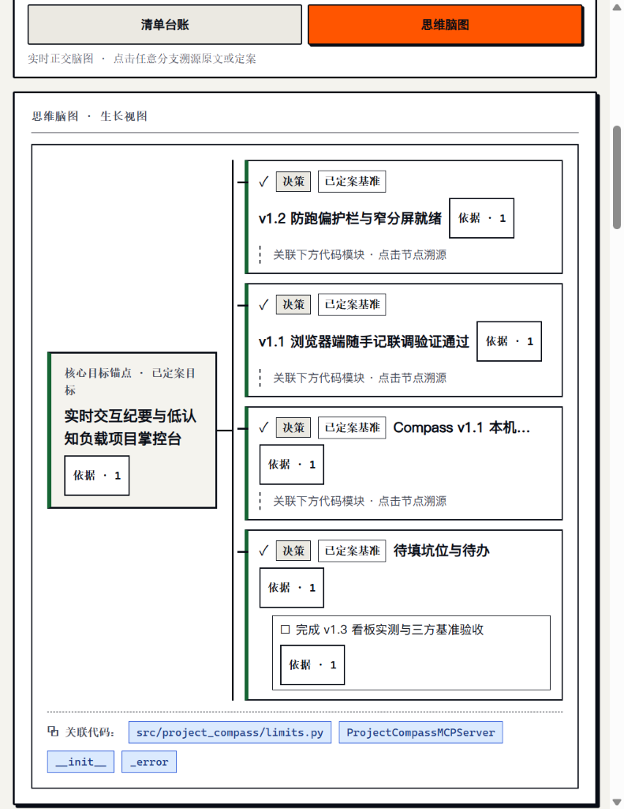
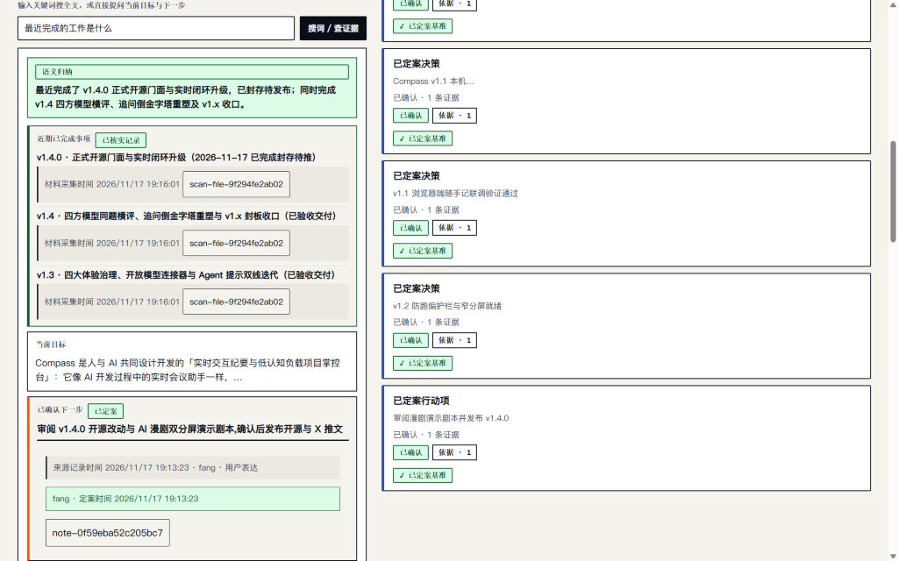
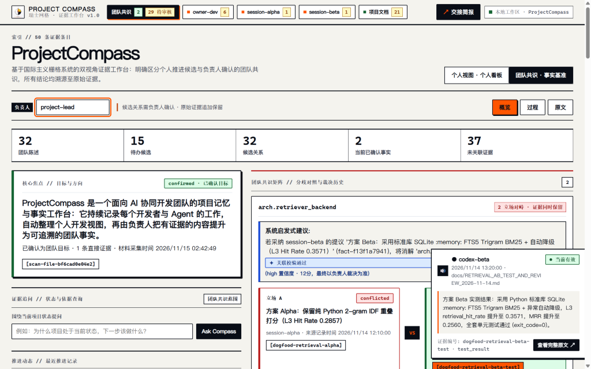
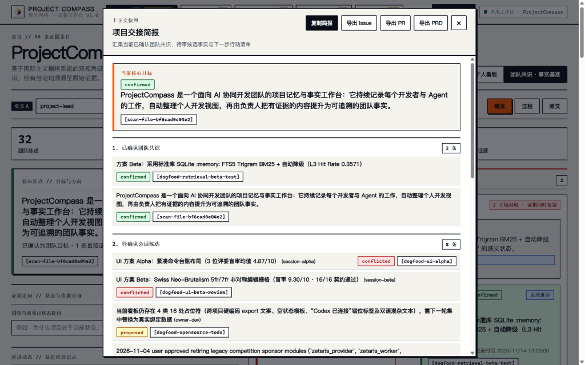

<p align="center">
  <picture>
    <source media="(prefers-color-scheme: dark)" srcset="docs/images/compass_style2_master_dark.svg">
    <source media="(prefers-color-scheme: light)" srcset="docs/images/compass_style2_master_light.svg">
    
  </picture>
</p>

<p align="center">
  <strong>Compass · Real-Time AI Development Notes &amp; Project Control Console (v1.4.0)</strong><br>
  人与 Coding Agent 结对开发的实时项目掌控台 —— 你一边和 AI 聊需求写代码，右侧伴侣看板实时长出思维导图、目标锚点与可溯源事实台账。
</p>

<p align="center">
  <a href="README_EN.md">English</a> • <a href="README.md">简体中文</a> • <a href="docs/PRODUCT_SPEC.md">产品规格</a> • <a href="docs/COMPASS_V1_4_MODEL_BENCHMARK_AND_UX_SEAL_2026-11-16.md">v1.4 评测与定版报告</a> • <a href="docs/INDEX.md">文档总索引</a>
</p>

<p align="center">
  <a href="LICENSE"></a>
  <a href="pyproject.toml"></a>
  <a href="pyproject.toml"></a>
  <a href="pyproject.toml"></a>
  <a href="server.json"></a>
  <a href="tests/"></a>
</p>

<p align="center">
  
</p>
<p align="center">
  <em>18 秒实景循环：左侧与 Agent 照常对话推进，右侧正交思维脑图同步生长；待定草案自动隔离防篡改，需求变更留下「新旧接替对照」，提问按倒金字塔先出结论与下一步。</em>
</p>

---

## ⚡ 为什么需要 Compass？

用 Coding Agent（Claude Code、Cursor、Antigravity、Codex CLI 等）做开发或长周期创作时，推进速度极快，但开发者往往很快丢失全局掌控感：

| 常见失控痛点 | 传统被动对话记忆 | 使用 **Compass v1.4.0** 之后 |
| :--- | :--- | :--- |
| **Agent 抢跑未确认脑洞** | 随口提一句备选方案，AI 当成圣旨改写全局代码 | 待定想法严格锁在「待拍板隔离区」，人工定案才进主线 |
| **聊久后目标漂移 / 新会话失忆** | 目标、已完结项和坑位淹没在终端日志与 JSONL 里 | 永久置顶 **核心目标 + 下一步共识**，新会话一键续接 |
| **检索满屏底层 JSON / 找不到下一步** | 搜“最近做了什么”，吐出几十行旧日志和未完待办 | **倒金字塔问答**：先给绿色「语义归纳 + 近期已完成」，再附引用 |
| **分歧与改版说不清谁覆盖了谁** | 静默覆盖旧记录，排错时查无实据 | 并列显示 **「旧方案 vs 新提案」人话接替说明** + 原话时间线 |

**Compass 把它做成“会同步生长的伴侣控制台”**：
1. **左写右长 · 正交思维导图**：将 IDE/聊天框放在左半屏、Compass 放在右半屏（适配 `540px–720px` 窄分屏）。对话与代码演进时，正交决策树实时从核心目标向右分支生长，关联底层 Python AST 模块。
2. **双锚点防跑偏护栏 + `Agent 提示`**：永久置顶锁定 **核心目标锚点** 与 **下一步工作共识**；`Agent 提示` 会主动提示高风险偏离与待核对证据缺口，待定想法绝不越权自动成为正式基准。
3. **倒金字塔式语义问答**：提问后先给出直接可读的「**语义归纳 / 当前目标 / 已确认下一步**」，再附核心命中证据，并将历史来源变更明细默认折叠置底。
4. **纯本地零依赖 + 可切换多模型**：仅用 Python 标准库即可开箱运行（`dependencies = []`）；接入自有密钥后，支持在页面右上角动态切换 `MiniMax-M3.1-Flash`、`MiniMax-M2.7`、`DeepSeek-Chat`、本机 `Ollama` 或一键退回纯本地检索。

---

## 📸 v1.4 界面全景实测

<p align="center">
  
</p>
<p align="center">
  <em>图 1：Compass v1.4 主工作台 —— 顶栏支持动态多模型切换与「个人路线 / 团队路线」视图，随手记一键记录思路，下方默认展开左→右正交「思维脑图 · 生长视图」</em>
</p>

<table align="center">
  <tr>
    <td width="42%" align="center" valign="top">
      
      <br><sub><em>图 2：窄分屏伴侣视图（680×880）—— 零横向溢出，适合贴靠 IDE 并排常驻，实时显影分支结构与关联代码节点</em></sub>
    </td>
    <td width="58%" align="center" valign="top">
      
      <br><sub><em>图 3：倒金字塔问答 —— 提问「最近完成的工作是什么」时先给绿色语义归纳与近期已完成，后接当前目标与核心溯源依据</em></sub>
    </td>
  </tr>
</table>

<p align="center">
  
</p>
<p align="center">
  <em>图 4：告别晦涩 JSON —— 点开任意分歧或待办卡片，直接用清晰人话并列对照「现行定案 vs 新近提案 / 新旧计划接替说明」与来源时间线</em>
</p>

<details>
<summary>展开查看底层工程特性截图：10px 悬停取证气泡 &amp; 续写快照/交接导出弹窗</summary>

<p align="center">
  
</p>
<p align="center">
  
</p>

</details>

---

## 🧭 两条路线，同一套只追加账本

右上角可随时切换视图模式（单人工作区默认开启个人路线，检测到多成员协同时自动适配团队路线）：

| 维度 | 个人路线（Solo Mode） | 团队路线（Team Mode） |
| :--- | :--- | :--- |
| **定位** | 个人与 AI 结对开发实时纪要，零多余审批仪式感 | 面向 2–4 人协同或并行多 Agent 的共识工作台 |
| **核心视角** | **实时纪要 · 待定思路** ↔ **已定案基准** + 正交思维脑图 | **个人视图** ↔ **团队共识 · 分歧裁决矩阵** |
| **防跑偏护栏** | 核心目标锚点 + 下一步工作共识 + `Agent 提示` 主动提醒 | 多成员在场状态、并列冲突证据、项目负责人审核拍板 |
| **历史溯源** | 所有覆盖、推翻均以追加记录留痕，任何卡片点开可见原话时间线 | 完整冲突保留（不静默覆盖），支持 10px 邻近预取原文透视 |
| **上下文续写** | 导出个人续写快照，一键粘贴进新对话窗口无缝续工 | 导出结构化交接简报（Markdown / GitHub Issue / PR / PRD） |

---

## ⚡ 3 分钟接入新项目 / 已有项目

支持 Python >= 3.10，核心包**零第三方依赖**。

### 第 1 步：安装命令行工具（二选一）

```bash
# 方式 A：源码本地可编辑安装（推荐）
git clone https://github.com/f22363712-dotcom/compass.git
cd compass
pip install -e .

# 方式 B：使用 uvx 免预装直接运行
uvx --from git+https://github.com/f22363712-dotcom/compass compass --sample --web
```

### 第 2 步：在你的项目目录注入协作守则与 MCP 配置

进入你要开发的项目根目录（哪怕是一个刚刚新建的空文件夹）：

```bash
# 1. 在项目根目录写入/更新 AGENTS.md 中的 Compass MCP 协作守则
compass-setup --project-path . --init-rules

# 2. 生成零配置客户端 MCP JSON（支持 antigravity / claude / cursor，加 --write 直接写入客户端配置）
compass-setup --client antigravity --project-path . --zero-config

# 3. 环境快速自检
compass-setup --doctor --project-path .
```

<details>
<summary>手动 MCP JSON 示例 &amp; 查看 6 项原生 MCP 工具清单</summary>

若你更习惯手动粘贴配置（以 `.cursor/mcp.json`、`claude_desktop_config.json` 或 Antigravity `mcp_config.json` 为例）：

```json
{
  "mcpServers": {
    "compass": {
      "command": "compass-mcp",
      "args": [
        "--project-path",
        "."
      ]
    }
  }
}
```

（未全局安装时，也可将 `"command"` 设为 `"uvx"`，`"args"` 为 `["--from", "git+https://github.com/f22363712-dotcom/compass", "compass-mcp", "--project-path", "."]`。）

接入后，Coding Agent 自动获得 **6 项原生 MCP 工具**：
1. `project_context`：开局或长对话压缩后，刷新并获取已定案目标基准、当前下一步共识、待拍板提案与历史分歧。
2. `record_note`：一步记账工具 —— 随手沉淀核心目标、决策选项、待验证假设或待办任务，并支持附带 `15~20` 字简练短标题。
3. `verify_completion`：报完工前门禁 —— 核验修改文件列表、验证状态、剩余未清待办及待处理分歧，并返回对话内 `nudge_lines` 提示。
4. `append_evidence`：追加公开会话记录与可复核的命令执行结果。
5. `query_state`：检索项目当前状态、分支立场及仍存在证据缺口的区域。
6. `propose_fact`：提交附带原文精确引用的结构化事实提案（未确认前保持 `proposed` 状态）。

</details>

### 第 3 步：打开伴侣看板并排开发

```bash
# 扫描项目文件与文档、生成标准库 AST 代码结构索引并启动 Web 看板
compass --scan . --extract-docs --with-code-index --web --port 8787
```

然后浏览 `http://127.0.0.1:8787/`，将浏览器拖到屏幕右半边（`540px–720px` 宽度即可），左边继续和 Coding Agent 对话写代码，右侧实时生长。

### 🌐 全局安装后：如何在其他项目与多个并发 Session 中打开使用？

只需全局安装一次 `pip install -e .` 并通过 `compass-setup --client antigravity --project-path ~/projects/default-workspace --zero-config --write` 写入全局配置后，**不需要每次切换项目都重复配置客户端**：

1. **接入任何其他项目**：切换到新项目目录执行 `compass-setup --project-path . --init-rules`。全局 `compass-mcp` 原生支持按每次工具调用传入的 `project_path` 动态路由——Agent 会自动把记忆隔离写入该项目自己的 `.project-memory/` 目录。
2. **同一项目并行开启多个会话（Session A / Session B）**：每个并行对话各自通过 `session_id` 参数隔离追踪自己的操作与发言，同时共享同一套项目定案基准；任一会话写入新事实后，跨会话上下文缓存会即时失效刷新。
3. **随时打开任意项目的独立 Web 看板**：进入那个项目目录执行不同端口即可同时查看：
   ```bash
   # 项目 B 启动独立伴侣看板（多项目并行查看时换不同端口即可）
   compass --open . --extract-docs --with-code-index --web --port 8788
   ```

其他常用启动模式：

```bash
# 打开已初始化工作区的项目并延续看板
compass --open . --extract-docs --with-code-index --web --port 8787

# 一键启动内置仿真示例数据体验完整交互
compass --sample --web --port 8787

# 回放自举研发（Dogfooding）JSON 数据集结构
compass --input examples/dogfood_project_compass.json --export-format json
```

---

## 🧠 可插拔多模型与 v1.4 四路同题对比测评

Compass **默认 100% 离线/纯本地检索即可运行**；如果你希望启用语义归纳、目标漂移研判与更自然的主动提示，只需在运行进程环境变量中配置你自己的 API Key（支持同时配置多路密钥，启动后可在看板顶栏即时切换，不将密钥写入仓库文件）：

```bash
# 示例（可仅配其中之一，或同时配置并列显示于顶栏下拉切换器）
export MINIMAX_API_KEY="your-minimax-key"      # 自动暴露 MiniMax-M3.1-Flash 与 MiniMax-M2.7
export DEEPSEEK_API_KEY="your-deepseek-key"    # 自动暴露 DeepSeek-Chat
export OLLAMA_HOST="http://127.0.0.1:11434"    # 自动暴露本机 Ollama 模型
```

### 同题四路评测结果（14 道真实现场测试题，同口径基准对照）

详细复盘、延迟采样与真实失效归因见：[v1.4 评测与定版报告](docs/COMPASS_V1_4_MODEL_BENCHMARK_AND_UX_SEAL_2026-11-16.md)。

| 对照路线 | 综合得分 | 关键事实抽取 (L2 F1 / Recall) | 回答准确率 (14 题) | 证据引用有效率 | 适用定位与说明 |
| :--- | :---: | :---: | :---: | :---: | :--- |
| **纯本地检索 (`v1.3` 基线)** | 39.8 / 100 | F1 `0.0909` | 35.71% (5/14) | **100%** | 零外网依赖、零成本，完全可保底运行 |
| **`MiniMax-M3.1-Flash`** *(推荐默认 · low 推理)* | 41.3 / 100 | **F1 `0.1525`** | 42.86% (6/14) | **100% (14/14)** | 单问界面延迟 `~2.55s–3.2s`，兼顾零幻觉引文与响应速度 |
| **`MiniMax-M2.7`** | 41.1 / 100 | F1 `0.1440` | **50.00% (7/14)** | **100%** | L2 契约率 `0.9907` (`106/107`)，适合复杂深问 |
| **`DeepSeek-Chat`** | **41.8 / 100** | Recall **`63.16%`** (12/19) | 28.57% (4/14) | 92.86% | 事实覆盖极高并成功保住双冲突立场（单问 `~1.79s`），偶发混入 1 例 `fact-*` 引用 |

> [!NOTE]
> 以上分值来自 `compass-eval` 统一评测基线实测记录，不夸大、不筛选用例；任何情况下若模型未启用、超时或密钥缺位，Compass 均会自动平滑退回纯本地检索，不阻断主工作流。

---

## 🧪 工程测试与自检

在仓库根目录执行全套校验（Python 单元测试 + Node VM 前端契约测试）：

```bash
# macOS / Linux
PYTHONPATH=src python3 -m unittest discover -s tests -q

# Windows (PowerShell)
$env:PYTHONPATH = 'src'; python -m unittest discover -s tests -q
```

如本机装有 Node.js，可一并运行 `tests/` 下的前端 VM 契约测试（验证思维导图正交渲染、倒金字塔问答布局、Solo/Team 状态机、XSS 逃逸与模型动态切换）：

```bash
node --check src/project_compass/web/app.js
for f in tests/*_test.cjs; do node "$f" src/project_compass/web/app.js; done
```

---

## 📄 开源声明与第三方许可

本项目基于 **[Apache License 2.0](LICENSE)** 开源发布。第三方组件与适配说明见 [THIRD_PARTY_NOTICES.md](THIRD_PARTY_NOTICES.md) 与 [licenses/learn-ai-basics-MIT.txt](licenses/learn-ai-basics-MIT.txt)。
