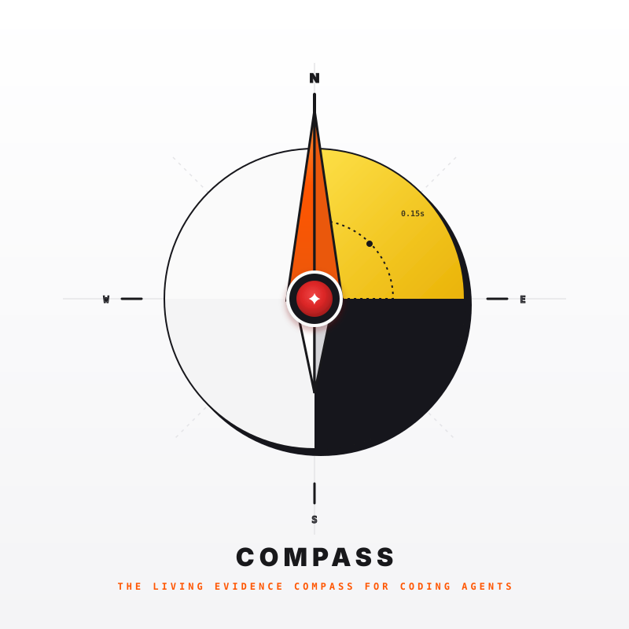
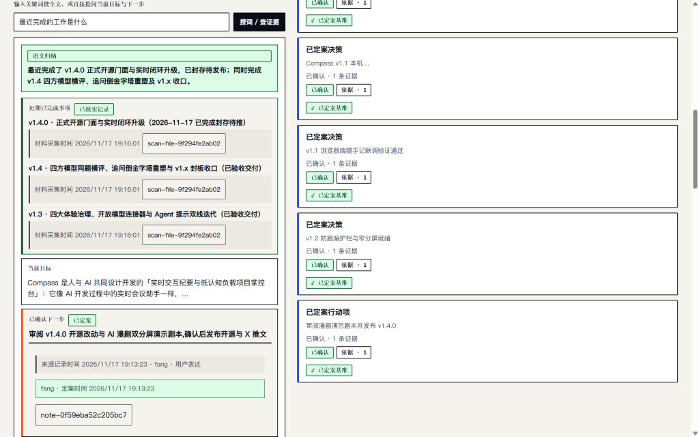

<p align="center">
  <picture>
    <source media="(prefers-color-scheme: dark)" srcset="docs/images/compass_style2_master_dark.svg">
    <source media="(prefers-color-scheme: light)" srcset="docs/images/compass_style2_master_light.svg">
    
  </picture>
</p>

<p align="center">
  <strong>Compass · Real-Time AI Development Notes &amp; Project Control Console (v1.4.0)</strong><br>
  A real-time companion control console for building with Coding Agents — keep your IDE on the left while Compass grows an orthogonal mindmap, dual anchors, and an evidence-backed truth ledger on the right.
</p>

<p align="center">
  <a href="README_EN.md">English</a> • <a href="README.md">简体中文</a> • <a href="docs/PRODUCT_SPEC.md">Product Spec</a> • <a href="docs/COMPASS_V1_4_MODEL_BENCHMARK_AND_UX_SEAL_2026-11-16.md">v1.4 Benchmark Report</a> • <a href="docs/INDEX.md">Docs Index</a>
</p>

<p align="center">
  <a href="LICENSE"></a>
  <a href="pyproject.toml"></a>
  <a href="pyproject.toml"></a>
  <a href="pyproject.toml"></a>
  <a href="server.json"></a>
  <a href="tests/"></a>
</p>

<p align="center">
  
</p>
<p align="center">
  <em>18-second live loop: talk to your Agent on the left while the orthogonal mindmap grows on the right—unsettled proposals stay quarantined, plan updates leave plain-language trails, and questions answer top-down.</em>
</p>

---

## ⚡ Why Compass?

Building with Coding Agents (Claude Code, Cursor, Antigravity, Codex CLI, etc.) moves fast, yet humans quickly lose situational awareness:

| Common Failure Mode | Passive Chat / Raw Log Memory | With **Compass v1.4.0** |
| :--- | :--- | :--- |
| **Agents Acting on Unsettled Ideas** | A casual brainstorm turns into unwanted code/config rewrites | Tentative ideas stay quarantined in **Pending Proposals** until you approve |
| **Goal Drift & New-Thread Amnesia** | Early constraints and open tasks drown in verbose terminal logs | Pinned **Core Goal + Confirmed Next Step** anchors with instant snapshot handoff |
| **Buried Answers in Raw JSON** | Asking *"What changed recently?"* dumps raw diffs & unfinished TODOs | **Inverted-Pyramid Q&A**: green summary & chronological completions first, sources below |
| **Silent Overwrites on Plan Changes** | Old decisions vanish without explanation | Side-by-side **Plain-Language Supersede & Conflict View** + full timeline |

**Compass acts as a live side-by-side companion ledger during AI-assisted development**:
1. **Orthogonal Growth Mindmap (`540px–720px` Split-Screen Ready)**: Snap Compass beside your IDE or chat window. As work progresses, confirmed goals, decisions, tasks, and linked Python AST code nodes grow smoothly from left to right.
2. **Dual Anchors + Proactive `Agent Hints`**: Pin the confirmed **Core Goal** and **Confirmed Next Step** above the fold. Proactive hints flag drift, repeated work, or untested assumptions without silently rewriting settled truth.
3. **Inverted-Pyramid Semantic Q&A**: Answers put the **Semantic Summary**, **Current Goal**, and **Confirmed Next Step** at the top, followed by cited core evidence, while historical source-change notices collapse neatly at the bottom.
4. **Zero-Dependency Local Core + Pluggable Models**: Runs out of the box on Python's standard library (`dependencies = []`). Optionally attach your own API keys or local `Ollama` to switch dynamically between `MiniMax-M3.1-Flash`, `MiniMax-M2.7`, `DeepSeek-Chat`, `Ollama`, or pure local retrieval right from the header.

---

## 📸 v1.4 Showcase

<p align="center">
  
</p>
<p align="center">
  <em>Figure 1: Compass v1.4 Workbench — live header model switcher, Solo/Team route toggle, instant note capture, and left-to-right orthogonal growth mindmap</em>
</p>

<table align="center">
  <tr>
    <td width="42%" align="center" valign="top">
      
      <br><sub><em>Figure 2: Narrow companion split-screen (680×880) — zero horizontal overflow, designed to live alongside your IDE with branch trace &amp; code links</em></sub>
    </td>
    <td width="58%" align="center" valign="top">
      
      <br><sub><em>Figure 3: Inverted-pyramid Q&A — asking "What was finished recently?" surfaces the green semantic summary and verified chronological completions before evidence citations</em></sub>
    </td>
  </tr>
</table>

<p align="center">
  
</p>
<p align="center">
  <em>Figure 4: Zero cryptic JSON walls — click any conflict or plan update to compare settled truth vs. tentative proposals and read plain-language supersede timelines side by side</em>
</p>

<details>
<summary>More UI screenshots: 10px Proximity Hover Prefetch &amp; Handoff Snapshot Export Modal</summary>

<p align="center">
  
</p>
<p align="center">
  
</p>

</details>

---

## 🧭 Two Routes, One Append-Only Ledger

Switch anytime in the header (solo workspaces default to Solo Mode; multi-contributor workspaces adapt automatically to Team Mode):

| Dimension | Solo Mode (`个人路线`) | Team Mode (`团队路线`) |
| :--- | :--- | :--- |
| **Workflow Fit** | Fast single-developer + Agent sessions with zero ceremony | 2–4 person or multi-agent engineering consensus workbench |
| **Primary Views** | **Live Notes · Pending** ↔ **Settled Baseline** + Orthogonal Mindmap | **Personal View** ↔ **Team Consensus · Conflict Resolution Matrix** |
| **Drift Guardrails** | Core Goal anchor + Next Step anchor + proactive Agent hints | Member presence strip, side-by-side conflicting evidence, owner review queue |
| **Auditability** | Append-only event history; every card expands back to exact utterances | Non-destructive conflict retention with 10px proximity hover citations |
| **Continuation** | Export concise context snapshot to resume in a fresh chat thread | Export structured handoff briefs (Markdown, GitHub Issue, PR, or PRD) |

---

## ⚡ 3-Minute Setup for New or Existing Projects

Requires Python >= 3.10 with **zero external runtime dependencies** (`dependencies = []`).

### Step 1: Install (or Run Zero-Install via `uvx`)

```bash
# Option A: Editable local install (recommended)
git clone https://github.com/f22363712-dotcom/compass.git
cd compass
pip install -e .

# Option B: Try immediately via uvx
uvx --from git+https://github.com/f22363712-dotcom/compass compass --sample --web
```

### Step 2: Initialize Project Rules & Zero-Config MCP

Inside any project folder (even a brand-new empty directory):

```bash
# 1. Install or update Compass MCP workflow rules in AGENTS.md
compass-setup --project-path . --init-rules

# 2. Generate zero-config MCP JSON (supports antigravity / claude / cursor; add --write to update host config)
compass-setup --client antigravity --project-path . --zero-config

# 3. Verify environment health
compass-setup --doctor --project-path .
```

<details>
<summary>Manual MCP JSON Snippet &amp; All 6 Native MCP Tools</summary>

Example entry for `.cursor/mcp.json`, `claude_desktop_config.json`, or Antigravity `mcp_config.json`:

```json
{
  "mcpServers": {
    "compass": {
      "command": "compass-mcp",
      "args": [
        "--project-path",
        "."
      ]
    }
  }
}
```

(Without global install, set `"command": "uvx"` and `"args": ["--from", "git+https://github.com/f22363712-dotcom/compass", "compass-mcp", "--project-path", "."]`.)

Connected Coding Agents receive **6 native MCP tools**:
1. `project_context`: Refresh and inspect settled goal/next-step anchors, confirmed facts, pending proposals, and open conflicts at task start or after context compaction.
2. `record_note`: One-step note recorder for goals, decisions, assumptions, or tasks with concise human-readable titles.
3. `verify_completion`: Pre-completion gate checking changed files, verification gaps, pending tasks, and in-chat `nudge_lines`.
4. `append_evidence`: Append public discussion turns and verifiable command execution records.
5. `query_state`: Query workspace state, divergent positions, and unresolved evidence gaps.
6. `propose_fact`: Submit structured fact proposals with exact source quotes (held as `proposed` until confirmed).

</details>

### Step 3: Launch the Live Companion Workbench

```bash
# Scan files, extract documentation facts, build stdlib AST code index, and open Web UI
compass --scan . --extract-docs --with-code-index --web --port 8787
```

Open `http://127.0.0.1:8787/` and snap it next to your IDE (`540px–720px` width works cleanly in split view).

### 🌐 Multi-Project & Parallel Session Workflow (Global MCP)

After installing once (`pip install -e .`) and writing your global host entry (`compass-setup --client antigravity --project-path ~/projects/default-workspace --zero-config --write`), **you never need to edit global MCP config again when opening new repositories or concurrent chats**:

1. **Any Other Repository**: Run `compass-setup --project-path . --init-rules` inside that repository. Passing `project_path` on tool calls dynamically routes Compass to that project's isolated `.project-memory/` directory.
2. **Parallel Sessions (Session A / Session B) on the Same Repo**: Pass distinct `session_id` values per chat thread so concurrent agents keep separate session traces while sharing one settled project baseline (writes automatically invalidate stale cross-session context caches).
3. **Side-by-Side Web Console per Project**: Open any project's visual dashboard anytime on its own port:
   ```bash
   compass --open . --extract-docs --with-code-index --web --port 8788
   ```

Additional commands:

```bash
# Re-open an existing Compass workspace
compass --open . --extract-docs --with-code-index --web --port 8787

# Explore built-in deterministic sample workspace
compass --sample --web --port 8787

# Export included dogfooding dataset as JSON
compass --input examples/dogfood_project_compass.json --export-format json
```

---

## 🧠 Optional Multi-Model Enhancement & v1.4 Benchmark

Compass works **100% locally with zero API keys**. To unlock semantic synthesis, dynamic profile switching in the header, and richer proactive hints, supply one or more provider credentials in your process environment (never commit secrets):

```bash
export MINIMAX_API_KEY="your-minimax-key"      # Registers MiniMax-M3.1-Flash & MiniMax-M2.7
export DEEPSEEK_API_KEY="your-deepseek-key"    # Registers DeepSeek-Chat
export OLLAMA_HOST="http://127.0.0.1:11434"    # Registers local Ollama endpoint
```

### 4-Way Same-Task Benchmark Summary (14 Real Project Questions)

Full methodology, latency breakdowns, and failure diagnostics are documented in [docs/COMPASS_V1_4_MODEL_BENCHMARK_AND_UX_SEAL_2026-11-16.md](docs/COMPASS_V1_4_MODEL_BENCHMARK_AND_UX_SEAL_2026-11-16.md).

| Profile | Overall Score | Fact Extraction (L2 F1 / Recall) | Answer Accuracy (14 Qs) | Evidence Validity | Practical Tradeoff |
| :--- | :---: | :---: | :---: | :---: | :--- |
| **Local Retrieval Baseline (`v1.3`)** | 39.8 / 100 | F1 `0.0909` | 35.71% (5/14) | **100%** | Zero network calls, zero token cost |
| **`MiniMax-M3.1-Flash`** *(Recommended · low reasoning)* | 41.3 / 100 | **F1 `0.1525`** | 42.86% (6/14) | **100% (14/14)** | `~2.55s–3.2s` UI latency with 100% valid citations |
| **`MiniMax-M2.7`** | 41.1 / 100 | F1 `0.1440` | **50.00% (7/14)** | **100%** | `0.9907` L2 contract score (`106/107`), strongest complex QA |
| **`DeepSeek-Chat`** | **41.8 / 100** | Recall **`63.16%`** (12/19) | 28.57% (4/14) | 92.86% | High recall preserving dual conflicts (`~1.79s` UI); 1 `fact-*` citation slip |

> [!NOTE]
> All numbers above come directly from `compass-eval` runs on the same evaluation corpus. Whenever a cloud endpoint is unconfigured or unreachable, Compass automatically falls back to pure local retrieval without interrupting the workbench.

---

## 🧪 Running Verification Tests

Run the full test suite from the repository root:

```bash
# macOS / Linux
PYTHONPATH=src python3 -m unittest discover -s tests -q

# Windows (PowerShell)
$env:PYTHONPATH = 'src'; python -m unittest discover -s tests -q
```

If Node.js is installed, also run the frontend VM contract suite covering orthogonal mindmap rendering, inverted-pyramid Q&A layout, Solo/Team transitions, XSS escaping, and live model switching:

```bash
node --check src/project_compass/web/app.js
for f in tests/*_test.cjs; do node "$f" src/project_compass/web/app.js; done
```

---

## 📄 License & Notices

Released under the **[Apache License 2.0](LICENSE)**. See [THIRD_PARTY_NOTICES.md](THIRD_PARTY_NOTICES.md) and [licenses/learn-ai-basics-MIT.txt](licenses/learn-ai-basics-MIT.txt) for third-party notices.
