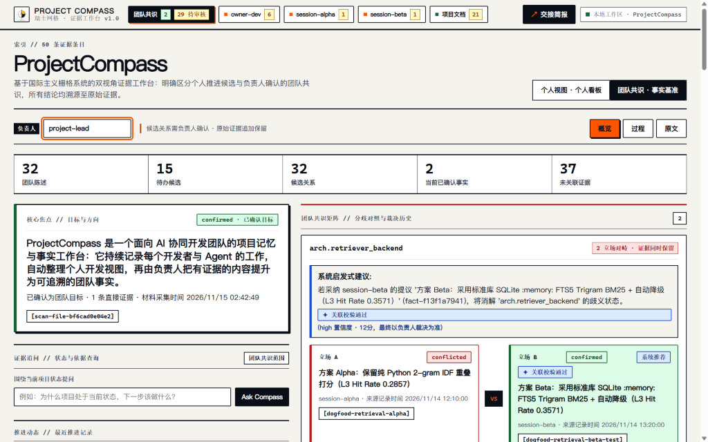
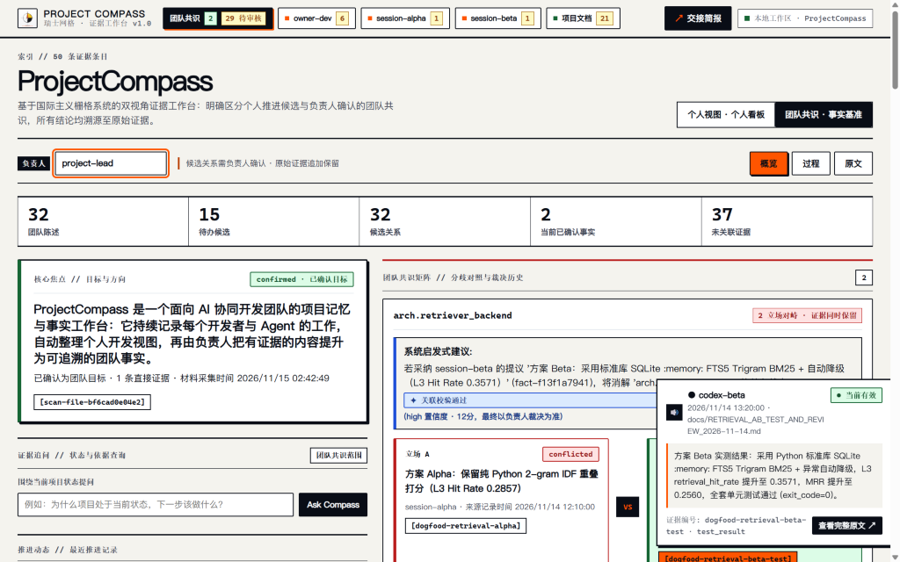
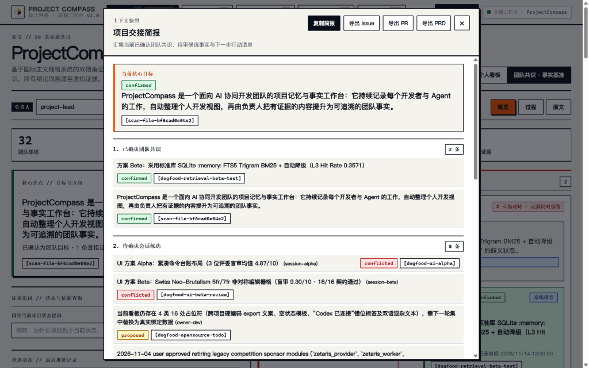
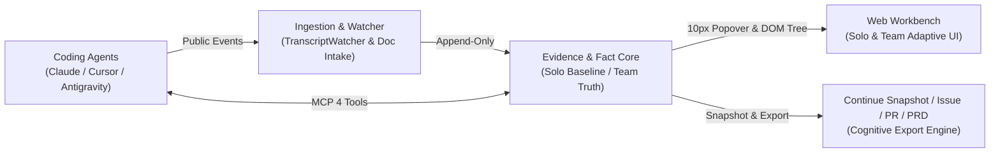

<p align="center">
  <picture>
    <source media="(prefers-color-scheme: dark)" srcset="docs/images/compass_style2_master_dark.svg">
    <source media="(prefers-color-scheme: light)" srcset="docs/images/compass_style2_master_light.svg">
    
  </picture>
</p>

<p align="center">
  <strong>Compass · Real-Time AI Development Notes &amp; Truth Workbench (v1.0)</strong><br>
  A real-time interactive meeting assistant and low-cognitive-load control center for building with Coding Agents — start solo, scale to team consensus.
</p>

<p align="center">
  <a href="README_EN.md">English</a> • <a href="README.md">简体中文</a> • <a href="docs/PRODUCT_GOAL.md">Product Goal</a> • <a href="docs/INDEX.md">Docs Index</a>
</p>

<p align="center">
  <a href="LICENSE"></a>
  <a href="tests/"></a>
  <a href="pyproject.toml"></a>
  <a href="docs/INDEX.md"></a>
  <a href="THIRD_PARTY_NOTICES.md"></a>
  <a href="https://modelcontextprotocol.io/"></a>
</p>

---

## ⚡ Why Do We Need Compass?

Building with coding agents is fast, yet developers quickly lose grip on what is actually happening:

* **Cryptic IDE Diffs & Log Noise**: Hundreds of generated lines and massive JSONL session logs create heavy cognitive load—especially for vibe coders and non-traditional builders who want clear intent rather than low-level diffs.
* **Agents Jumping Ahead of Unsettled Ideas**: A tentative idea you were only brainstorming can silently get treated as an established premise before you ever signed off on it.
* **Context Amnesia Across Sessions**: Crucial rationale scatters across yesterday's threads, making it hard to search "why did we pick this?" or resume cleanly in a fresh window.

**Compass acts as a live interactive meeting assistant for human–AI co-creation**:
1. **Live Notes with Hard Tentative vs. Committed Separation**: Tracks what you and the agent just did, which ideas remain tentative assumptions, and which decisions are explicitly committed into your project baseline.
2. **Solo-First → Team Adaptive Modes**: Choose **Solo Mode** for zero-ceremony individual control (your actions, open thoughts, and one-click baseline commits), or switch to **Team Mode** when collaborators join to inspect multi-member presence, side-by-side conflict triage, and review queues.
3. **10px Proximity Prefetch & Instant Citation Verification**: Move within `10px` of any `[evidence-id]` pill to prefetch its raw backing record; hover or focus to inspect the original quote, author, timestamp, and freshness badge (`● 当前有效`).

---

## 🧭 Two Modes, One Append-Only Ledger

Switch between routes directly from the top bar (single-contributor workspaces default to **Solo Mode**, while multi-contributor workspaces automatically surface **Team Mode**):

| Dimension | Solo Mode (个人路线) | Team Mode (团队路线) |
| :--- | :--- | :--- |
| **Primary Role** | Live personal AI dev notebook with zero approval ceremony | Multi-member / multi-agent consensus workbench |
| **Dual Lenses** | **Live Notes · Tentative Thoughts** ↔ **Project Baseline · Committed** | **Personal View** ↔ **Team Consensus · Shared Truth** |
| **Commit Flow** | Commit tentative ideas to your project baseline in-card or directly in the drawer; remembers your signature locally | Preserves competing stances side-by-side with explicit owner triage & audit trail |
| **Export Flow** | Generate a **Personal Context Snapshot** to resume seamlessly in a new AI chat | Export structured **Handoff Briefs** (GitHub Issue / PR / PRD) |

---

## 📸 Interface Overview

<p align="center">
  
</p>
<p align="center">
  <em>Swiss Neo-Brutalism (5fr/7fr) workbench with Solo/Team mode toggle: left rail for focal direction, evidence search, and live stream; right stage for tentative notes, committed baselines, and side-by-side conflict resolution.</em>
</p>

<p align="center">
  
  
</p>

---

## ⚡ Quick Setup (Native MCP & Local Workbench)

Built strictly on Python's standard library (**zero external runtime dependencies**, `dependencies = []`), ready out of the box for **Model Context Protocol (MCP)**.

### Option 1: Attach as an MCP Server (Cursor / Claude Desktop / Windsurf)
Add this snippet to `.cursor/mcp.json` or `claude_desktop_config.json`:

```json
{
  "mcpServers": {
    "compass": {
      "command": "uvx",
      "args": [
        "--from",
        "git+https://github.com/f22363712-dotcom/compass",
        "compass-mcp",
        "--project-path",
        "."
      ]
    }
  }
}
```

Connected agents immediately receive **4 native tools**:
* `project_context`: Fetch committed project baselines, verified facts, and active conflicts.
* `append_evidence`: Safely record public session messages and verifiable execution logs.
* `query_state`: Search project state, unresolved thoughts, disagreements, or expand any `evidence_id`.
* `propose_fact`: Submit a candidate fact or tentative decision backed by an exact quote.

> 💡 **Zero-Config Local vs. Remote HTTP Mode**:  
> Without `--base-url`, `compass-mcp --project-path .` reads and writes directly to your local `.project-memory/` store. To connect to a running shared server, pass `--base-url http://127.0.0.1:8787` and set `PROJECT_COMPASS_AGENT_TOKEN`.

### Option 2: Launch the Visual Dashboard in One Command

Run directly via `uvx` without manual cloning:

```bash
# Scan current repository (zero-LLM doc extraction + stdlib AST code graph) and open the UI
uvx --from git+https://github.com/f22363712-dotcom/compass compass --scan . --extract-docs --with-code-index --web

# Explore the bundled offline sample workspace
uvx --from git+https://github.com/f22363712-dotcom/compass compass --sample --web
```

Or install locally from source:

```bash
git clone https://github.com/f22363712-dotcom/compass.git
cd compass
pip install -e .

compass --open . --extract-docs --with-code-index --web
compass --sample --web --port 8787
compass --input examples/dogfood_project_compass.json --export-format json
```

---

## 🧪 Engineering Discipline & Test Suite

Compass treats verifiable evidence and deterministic regression gates as first-class assets:

* **Full Automated Regression Suite**: Covers local `ThreadingHTTPServer` state and review lifecycles, exact quote span verification, stdlib AST multi-hop code context, Solo/Team mode rendering contracts, XSS sanitization, and startup recovery.
* **Honest Reporting**: No fabricated truth states, no hidden chain-of-thought exposed as evidence; every confirmed item remains linked to immutable sources. See [docs/INDEX.md](docs/INDEX.md).

Run tests from the repository root:
```bash
PYTHONPATH=src python3 -m unittest discover -s tests -q
```

---

## 🗺️ Architecture & Roadmap



* **v1.0 (Current Release)**: Solo-First → Team dual-mode workbench, append-only provenance ledger, 10px hover quoting, AST call-graph links, MCP 4 tools, and cognitive exports.
* **vNext (Planned — Proactive Model Health Insights)**: Model-assisted background diagnostics that warn builders early when CSS/UI patterns fragment across components, when implementation depends on an unverified assumption, or when duplicate logic starts drifting.

---

## 📄 Notices & Licensing

Licensed under **[Apache License 2.0](LICENSE)**. See [THIRD_PARTY_NOTICES.md](THIRD_PARTY_NOTICES.md) and [licenses/learn-ai-basics-MIT.txt](licenses/learn-ai-basics-MIT.txt).
