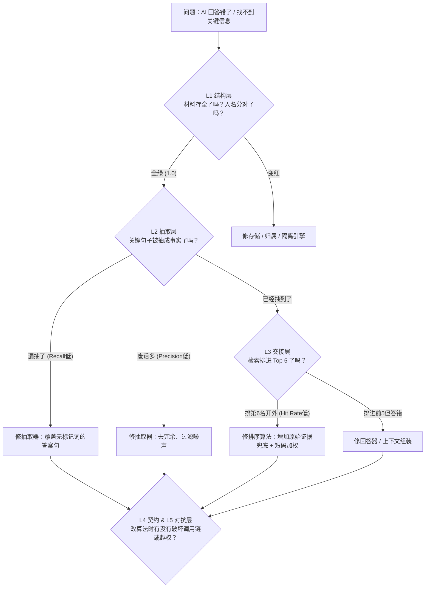

# 🔍 如何利用五层测评架构「发现问题 ➔ 定位根因 ➔ 驱动解决」

> **核心思想**：测评体系不是考试结束后的“成绩单”，而是一台**“工程 X 光机（诊断漏斗）”**。当系统表现不佳时，五层架构能把模糊的“AI 好像不太行”，精准切割成具体某一行代码的可验证修复方案。

---

## 一、 因果诊断漏斗：从“现象”层层剥洋葱到“代码根因”

在没有分层测评之前，AI 回答错了一个问题，开发者往往无从下手。而在 Project Compass 的五层结构中，排错是一条清晰的**逐层排除漏斗**：

### 用真实基线数据举例（来自 `docs/COMPASS_ITERATION_PLAN.md`）

1. **先用 L1 排除底层假嫌疑**：
   - `L1` 全部 1.0000（423/423 条证据写入、零越权晋升）。
   - **结论**：存储和隔离完全健康，**绝不把时间浪费在重写底层存储上**。
2. **用 L2 与 L3 的数字落差，揪出“真病灶”**：
   - 观察基线：`L3 evidence_coverage = 0.5714`（8/14 道题的证据已经被抽成了事实），但 `L3 retrieval_hit_rate = 0.2143`（只有 3/14 道题排进了前 5）。
   - **立刻发现第一个大问题（检索断层）**：有 **5 道题** 的证据**明明已经在库里**，却没排进前 5！顺着代码查到 `literal_relevance.rank_literal`，发现它只在已抽出的事实里做纯字面 n-gram 匹配，把 `F0`、`case-002` 这种关键短码切碎了，且事实层漏抽时没有回退到原始事件搜索。
   - **立刻发现第二个大问题（抽取盲区与高噪声）**：剩下 6 道题证据压根没进事实层，而 `L2 precision` 只有 `0.0370`（抽 216 条只有 8 条有用）。顺着看参考抽取器，发现它只盯着“决定/负责/约定”等标记词，导致“具体做法/条件句”全部漏抽，同时废话一堆。
3. **用 L4 / L5 充当“安全保险丝”**：
   - 当我们动手优化 L2 抽取和 L3 检索去“刷高准确率”时，L1/L4/L5 随时盯着：有没有因为追求召回率而把 `proposed` 错放成 `accepted`？有没有改断了 AST 调用链？一旦触线，红线闸门瞬间拦下。

---

## 二、 工程闭环：四步解决问题的标准动作

每当测评报告指出一个低分项，标准解法严格遵循以下四步：

1. **逐题拆解（Failure Analysis）**：不要只看 `0.2143` 这个总分，把未命中的那 11 道题打印出来，分类归因（是“压根没抽到”还是“抽到了但没排进前 5”）。
2. **提出单一假设与最小改动（Hypothesis & Minimal Fix）**：例如假设“保留 `F0`、`case-002` 这类字母数字短码的完整权重，能把 5 道漏网题拉进 Top 5”。
3. **重跑同一条命令验证增量（Measure Delta）**：
   `PYTHONPATH=src python -m project_compass.eval run --corpus ... --baseline ...`
   看 `retrieval_hit_rate` 是否真的从 `0.2143` 涨到了 `0.45+`，同时确认 `L1 / L4 / L5` 红线依然全部为 `PASS`。
4. **先校准尺子（当前正在做的 PBR 治理）**：
   如果尺子本身是歪的（如 P0-B 空答案也能过、P1-A 分母同源恒为 1.0），上面的闭环就会失效。所以必须先把 `HANDOFF_TO_AGY_EVAL_REVIEW.md` 里的 PBR 缺陷修干净，再启动迭代优化。
