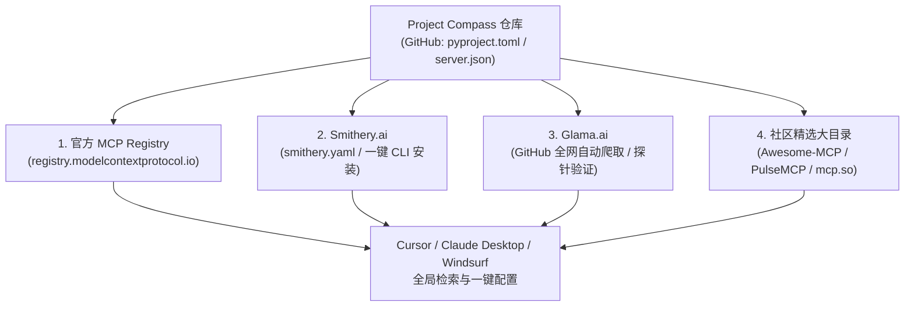

# Compass 1.0 · MCP 市场生态调研与全网入驻指南

> **撰写时间**：2026-11-07  
> **核心目标**：调研当前主流 MCP 市场 (Marketplace / Registry) 的收录机制，打通 Compass 在全球 MCP 目录中的直接检索与一键安装，并确立去营销化的真实工程师叙事范式。

---

## 一、MCP 市场生态全景版图 (The MCP Ecosystem)

目前全球开发者检索、发现和安装 MCP Server 的主要入口由以下四大阵地构成：



| 平台名称 | 平台定位 | 收录方式 | 开发者体验 (DX) | 权威度 |
| :--- | :--- | :--- | :--- | :---: |
| **Official MCP Registry** | Anthropic 官方规范注册表 | `server.json` + `mcp-publisher` 提交 | 官方权威背书，多端未来直接集成 | ⭐⭐⭐⭐⭐ |
| **Smithery.ai** | 当前规模最大、支持一键安装的平台 | `smithery.yaml` + CLI 一键部署 | 提供 `npx @smithery/cli install` 一键写配置 | ⭐⭐⭐⭐⭐ |
| **Glama.ai** | 主流开源 MCP 目录与健康监控平台 | GitHub 开源仓库自动全网抓取 + 认领 | 自动索引，开发者认领 (Claim) 获得控制权 | ⭐⭐⭐⭐ |
| **Awesome MCP Servers** | GitHub 顶流社区精选列表 (数万 Star) | 提交 GitHub Pull Request 审核收录 | 极客圈曝光极高，大量开发者从这里检索 | ⭐⭐⭐⭐ |

---

## 二、四大主流市场的具体入驻操作步骤

### 1. 官方 MCP Registry (registry.modelcontextprotocol.io)

官方 Registry 是未来所有标准客户端统一查询的上游源头。
我们已在项目根目录下生成符合官方 Schema 的规范清单：[`server.json`](../server.json)。

#### 发布操作步骤：
1. **安装官方发布工具**：
   ```bash
   npm install -g @modelcontextprotocol/publisher
   ```
2. **校验与提交清单**：
   ```bash
   mcp-publisher validate server.json
   mcp-publisher publish
   ```
3. **命名空间与域名验证**：
   官方通过 DNS TXT 记录对发布者的组织或域名进行验证，确保包名命名空间（如 `project-compass`）的权威归属。

---

### 2. Smithery.ai (一键安装注册中心)

Smithery 允许终端用户**无需手动编辑 JSON 配置文件**，直接敲一行命令自动将 Compass 写入 Cursor 或 Claude Desktop。
我们已在根目录下生成了标准配置文件：[`smithery.yaml`](../smithery.yaml)。

#### 发布操作步骤：
1. **使用 Smithery CLI 注册发布**：
   ```bash
   npx -y @smithery/cli publish
   ```
   *（或者在 [smithery.ai](https://smithery.ai) 网页端点击「Submit Server」，输入 GitHub 仓库 URL，Smithery 会自动读取 `smithery.yaml` 并完成索引）*。
2. **验证终端用户的一键安装体验**：
   上架后，任何开发者只需在终端运行以下命令，即可全自动配置好 Cursor：
   ```bash
   npx -y @smithery/cli install project-compass --client cursor
   ```
   这会将 `uvx project-compass-mcp --project-path .` 自动追加进用户的 Cursor 配置中。

---

### 3. Glama.ai (开源自动索引与认领)

Glama.ai 采用**全网自动化扫描机制**：
- 只要 GitHub 仓库为 Public，并且包含 MCP 相关的元数据（README 中包含 Model Context Protocol、`pyproject.toml` 或 `server.json`），Glama 的爬虫会自动将其收录进 [glama.ai/mcp/servers](https://glama.ai)。

#### 认领与接管步骤：
1. 在 [glama.ai](https://glama.ai) 搜索框搜索 `ProjectCompass` 或你的仓库名；
2. 进入 Connector 页面，点击 **「Claim ownership」**；
3. 使用你的 GitHub 账号一键授权登录（要求账号是该仓库的 Owner 或 Admin）；
4. 认领成功后，可在后台查看：
   - 每日工具调用量 (Analytics)
   - 服务器健康心跳 (Health Check)
   - 自定义展示标签与使用说明。

---

### 4. 社区精选目录：Awesome MCP Servers

GitHub 仓库 `punkpeye/awesome-mcp-servers` 是目前社区 Star 最多、最受推荐的汇总列表。

#### PR 提交模板：
在 `README.md` 的 **Development & Code** 分类下增加一行：
```markdown
- [Project Compass](https://github.com/your-org/ProjectCompass) - Local-first evidence & truth compass for coding agents in Cursor & Claude Desktop. 0.15s hover citation, fact triage, and zero-DB architecture.
```
发起 Pull Request 后，通常 24-48 小时内会被合并，迅速带来数千名精准的 AI 开发者关注。

---

## 三、开发者上手体验的代际跃迁

用户敏锐地指出，当今的开发者根本不再愿意走传统繁琐的四步流程（`clone -> venv -> pip -> env`）。
现代开发者工具必须满足以下三重极简体验：

| 接入方式 | 传统做法 | Compass 1.0 现代做法 | 耗时 |
| :--- | :--- | :--- | :---: |
| **Agent 原生配置** | 开发者自己查文档、手写 JSON、查系统绝对路径 | 直接丢一句话给 Agent：<br>*“帮我把 Project Compass 加为 MCP，用 uvx 运行”* | **3 秒** |
| **免装运行** | 手动建虚拟环境、安装依赖、编译扩展 | **`uvx project-compass --open . --web`**<br>(基于 Astral uv，零环境污染，即跑即用) | **5 秒** |
| **市场一键安装** | 寻找安装包、解压配置 | **`npx @smithery/cli install project-compass`** | **10 秒** |

---

## 四、去营销化的真实工程师叙事力量

### 为什么营销套话会引发工程师反感？
1. **辞藻堆砌**：像“史诗级”、“范式转移”、“颠覆传统”等字眼，早已被币圈和营销号过度透支；程序员对这类大词的第一反应是“又是一个套壳的玩具”。
2. **痛点失真**：把问题无限放大为“世界末日”、“毁灭性灾难”，显得做作而不真实。

### 简朴而有力量的表达法则：
1. **真实的人与具体的场景**：
   - “上周深夜我和 Agent 结对写代码……”
   - “它提了一句‘用枚举是不是更好’，我随口回了句‘稍后看’，它却当成共识把后面 4 个文件全重构了……”
2. **真实的体感与情绪**：
   - “为了查明白是哪句话出了问题，我硬翻了几万行 JSON 日志，翻得眼睛发干，整个人快虚脱了。”
3. **克制的说明与清爽的交付**：
   - 不吹企业级大词，只说：“纯本地跑，不装数据库，不吃内存，帮我把好三道门。”
   - 这种文字能让每一个深夜写代码的程序员感同身受，产生极强的自发认同与信任。
