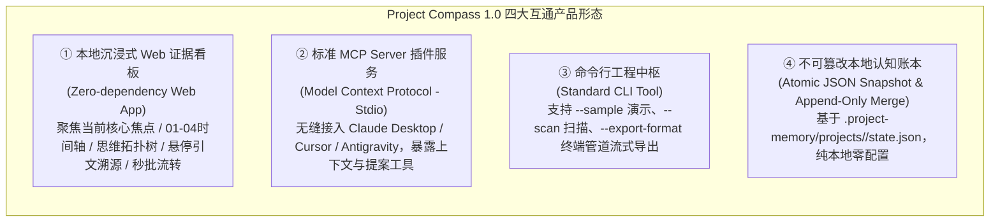
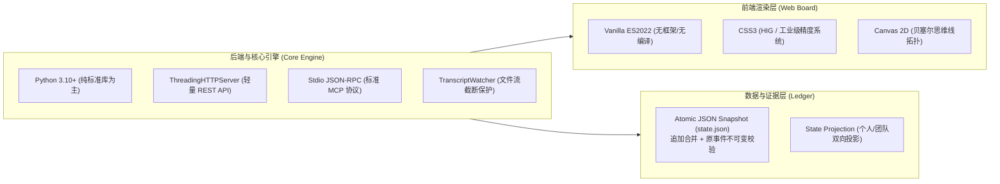

# Project Compass · 产品形态与技术栈全景规格书

- **版本**：v1.0.0
- **日期**：2026-11-14（M1 文档校准版）
- **定位**：面向人类注意力聚焦的 Multi-Agent 协作证据看板与不可篡改认知中枢

---

## 一、目前的产品形态 (Product Modalities)

Project Compass 并非传统的单一网页或云端 SaaS，而是一个**“即插即用的本地协作中枢 + 人类沉浸式证据看板”**，由四种互通形态协同组成：

1. **本地轻量 Web 证据看板 (Web Application)**
   - 运行在本地独立端口（如 `http://localhost:8790`）。
   - **核心交互**：展示 `01 目标确立 -> 02 方案选型 -> 03 模块推进 -> 04 共识核验` 阶段时间轴；以 Canvas 渲染思维演进树；悬停/键盘焦点呼出纯净原文证据气泡；提供卡片内联秒批、冲突分栏对照与一键交接简报（视觉样式将统一按 M3 规划收敛至 Swiss Neo-Brutalism）。
2. **标准 MCP Server 插件形态 (Model Context Protocol)**
   - 实现了 Stdio JSON-RPC 2.0 标准协议。
   - 任何支持 MCP 的 Agent（Claude Code、Claude Desktop、Cursor、Windsurf 等）无需修改源码，通过一键配置即可调用：`project_context`、`append_evidence`、`query_state`、`propose_fact`。
3. **命令行工程中枢 (CLI Tooling)**
   - 包含 `project-compass`、`project-compass-mcp` 与 `project-compass-setup` 命令；
   - 支持自动化脚本调用、评委极速验证（`--sample`）、对话文件持续挂载（`--antigravity-transcript`），以及将已确认共识管道化导出为 GitHub Issue / PR / PRD。
4. **不可篡改本地认知账本 (Append-only Ledger)**
   - 存储于本地项目根目录下的 `.project-memory/`，无需任何配置，数据完全私有且可版本控制。

---

## 二、底层技术栈全景 (Technology Stack)

整个项目奉行**“极简工业级、零外部重型依赖、极致启动速度”**的架构美学：

### 1. 后端与核心引擎 (Backend & Engine)
- **开发语言**：**Python 3.10+**。
- **Web 服务与网络通信**：
  - 基于 Python 标准库 `http.server.ThreadingHTTPServer`，提供并发线程安全的 REST API（`/api/state`, `/api/review`, `/api/refresh`, `/api/export`）；
  - 纯标准库实现，彻底清退了外部复杂依赖（无 Flask/FastAPI 沉重生命周期，无外部数据库驱动）。
- **实时增量流式引擎**：
  - 自研 `TranscriptWatcher`：具备**行截断保护机制 (Line-incompleteness Protection)**，在流式追加中途安全挂起未完结行，避免脏数据写入；
  - 增量行偏移指针（Byte Offset Tracking），实现轻量轮询同步。
- **协议与接口层**：
  - 标准 **Model Context Protocol (MCP)**（Stdio 传输，JSON-RPC 2.0）；
  - 针对 Antigravity 的 `AntigravityTranscriptAdapter`（具备隐藏思考 CoT 剔除与凭据过滤能力）。

### 2. 前端展示与交互层 (Frontend & Ergonomics)
- **核心理念**：**零构建流水线 (No Build Step)** —— 无需复杂打包工具、无需 Webpack/Vite 编译，修改即生效，直接交付。
- **语言与语法**：**原生 JavaScript (ES2022)** + **原生语义化 HTML5**，严格通过 `node --check` 与 Node VM 契约测试校验。
- **样式与美学**：
  - **原生现代 CSS3**（CSS Variables 体系、Flexbox/CSS Grid、自适应排版）；
  - 统一工程化高对比视觉体系（见 [UI_STYLE_GUIDE_MANUAL.md](UI_STYLE_GUIDE_MANUAL.md)）。
- **动态图形**：原生 **HTML5 Canvas 2D** 动态计算并绘制自适应曲线，连接目标锚点与决策分支，直观还原“思维与逻辑脉络树”。

### 3. 数据持久化与一致性 (Persistence & State)
- **底层账本**：工作区项目状态保存于 `<workspace_root>/state.json`（搭配项目发现索引 `registry.json`），采用临时文件 + `os.replace` 原子提交语义；`ProjectWorkspace.save()` 按事件 ID 执行不可变追加合并（同 ID 异内容直接报错拒绝覆盖），另保留 `EvidenceStore.load_jsonl()` 兼容导入 JSONL 输入流。
- **状态投影机制 (Projection)**：
  - 基于不可变事件流动态投影为“个人看板（Personal View / Proposed）”与“团队事实（Team Truth / Confirmed）”；
  - 采用精确事实键同步（Exact Key Matching），彻底消除状态裂脑。

### 4. 质量保障与测试工程 (Quality & Testing)
- **测试框架**：Python 标准库 `unittest`（零第三方测试框架依赖）。
- **测试校验**：通过 `python -m unittest discover -s tests -q` 与 `python -m project_compass.eval run` 实跑输出核验（当前回归基线 515+ tests，禁止在文档中以过时静态数字替代真实命令执行）。
- **审查与测试范式**：
  - 涵盖真实 HTTP 套接字端到端契约测试与样本隔离测试（拒绝假绿）；
  - 严格落地 **IEEE TSE 2001 PBR (Perspective-Based Reading)** 三视角（用户视角 / 架构数据流视角 / 对抗测试视角）代码审查门禁。
