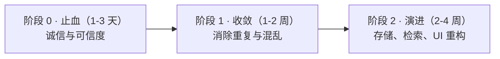

# Project Compass 项目健康度审查报告（面向长期维护）

> 审查基线：`codex/evidence-links` @ `f5b84ec` · 日期：2026-11-14
> 方法：4 路并行审查（Python 后端、前端代码、技术路线与测评、真实浏览器 UI 走查）+ 本人抽样复核截图与命令输出。
> 标注约定：**【实测】** = 已运行命令/脚本复现；**【代码】** = 读代码得出；**【推断】** = 未实际触发，仅从代码路径推出。

---

## 〇、一句话结论

Compass 的**内核理念是对的，而且做得扎实**：精确引文门、`proposed` 不自动晋升、冲突双边保留、零依赖本地优先。这几条正是这个产品值得长期维护的理由。

问题集中在**内核外围**。几个月的 AI 高速迭代留下了明显痕迹：

- **同一件事被实现了很多遍**：成员归属、"公开事件"判定、状态徽章、长度上限，各写一套。
- **文档只增不减**：162 份文档，其中 84 份是一次性审查记录。
- **测评分数正在被"刷"**：其中一部分是我上一轮迭代造成的，见 §2.2。
- **UI 存在三套视觉语言并存**。

所以下一阶段的主题不是加功能，而是**收敛**。

| 维度 | 评级 | 核心问题 |
|---|---|---|
| 内核正确性（事实/证据/晋升红线） | 🟢 良好 | 红线测试齐全；但"公开事件"和"成员归属"的定义已经分叉 |
| 代码一致性（硬编码/重复） | 🔴 差 | 同一过滤逻辑写了 9 处以上；`1600` 写死在 6 个文件；中文意图词表分散在 4 个模块 |
| 冗余残留 | 🟡 中 | 根目录残留黑客松文件；约 10 个函数无人调用；`requirements-zetaris.txt` 遗留 |
| 文档治理 | 🔴 差 | 162 份文档；测试数在 5 处文档里写了 5 个不同的数 |
| 技术路线 | 🟡 适合当前，扩展受限 | JSON 整份重写 + 无跨进程锁；每次请求全量重推导 |
| 测评体系 | 🔴 分数不可信 | 被测对象与产品路径不一致；L3 被"倾倒式答案"放大；存在对金标准的过拟合 |
| UI 可视化 | 🟡 可用但不统一 | 3 套视觉语言混用；状态语义有 5 套映射；可访问性不达 AA |
| 工程基建 | 🔴 缺失 | 无 CI、无 linter/formatter |

---

## 一、AI Coding 常见问题

### 1(a) 各处样式各自实现，没有统一交互标准

**前端【代码】**

**设计 Token 名存实亡**
- `styles.css` 的 `:root` 只定义了 17 个颜色变量，没有间距、圆角、字号 token。
- `:root` 之外仍有 **192 处写死的 hex**，共 95 种。其中 `#0f172a`、`#cbd5e1` 等值已经有对应变量，却仍在直接写死。
- **字号有 21 种**（9 / 9.5 / 10 / 10.5 / … / 15px），**圆角有 15 种**。
- `--vermilion` 和 `--rose` 定义了但从未使用。

**组件各写一套**
- 徽章/药丸类 class **15 种**，按钮类 class **约 11 种**。
- **没有共享的状态徽章渲染函数**。同一个状态在不同位置的显示分别是：
  - `app.js` L5 显示英文 `confirmed`；
  - L237 显示中文"冲突/待确认"；
  - L628 直接输出原始枚举值。
- "✦ 单测已验证"徽章用内联样式复制了 **6 份**（CSS 3 份 + JS 3 份）。
- L173 给元素加了 `.status-pill.accepted/.proposed`，但 **CSS 里没有对应规则**，所以两种状态看起来完全一样。

**交互没有统一标准**
- 空状态 `class="empty"` 是 39 处内联模板，没有 helper。
- 错误信息也复用 `.empty` 样式（L1163、L1188），视觉上**和"无数据"分不清**。
- `fetch` 共 15 处，没有统一封装：只有 `/api/state` 带超时和重试，其余 14 处都没有超时，**违反 AGENTS.md 中"外部调用必须有超时"的规定**。
- 有空 `catch (_e) {}`（L1021）。

**文档与实际不符**
- `UI_STYLE_GUIDE_MANUAL.md` 声明了 8pt 栅格、统一圆角、禁止软阴影、橙色主 CTA。
- 实际 CSS 中这些**都不成立**：仍有 4 处软阴影；交接主按钮是旧的墨绿 `#0d6e52`，该颜色共出现 11 次。
- `UI_VISUAL_OPTIMIZATION_REPORT.md` 里的 "CRAP 6.5→9.6" 评分**没有任何测量依据**。

### 1(b) 硬编码与重复逻辑

**后端【代码】**

| 问题 | 证据 |
|---|---|
| **"公开原始事件"判定写了 9 处以上，写法各不相同** | `evidence_linking.py:221,293`、`investigator.py:79-81,389`、`projections.py:203`、`l3_handoff.py:89`、`candidate_extraction.py:42`（只排除 `fact_proposal`）、`reason_preview.py:25`、`raw_source_investigation.py:115`；另有 5 处额外判断 `phase not in {'analysis','reasoning'}` |
| **成员归属逻辑分叉（会导致结果不一致）** | 标准实现 `candidate_extraction.py:36` 会查 `session_members`；`dashboard.py:401` 只写了 `metadata.member_id or author`；`raw_source_investigation.py:113` 又给 `git_commit` 加了特例。同一事件在看板和视图里**可能归给不同成员**【推断】 |
| 魔数散落 | `1600` 出现在 6 个文件；`512` 出现在 4 个文件；`24` 已有常量 `MAX_CANDIDATES_PER_PAYLOAD`，但 `runners.py:179` 和 `harness.py:46` 仍写死；`MAX_NODES/MAX_EDGES/UA_FORMAT` 在 `code_index.py` 和 `derived_context.py` 各定义一份，靠注释手动同步 |
| 中文意图路由硬编码 | `investigator.py` 有 77 行含中文的关键词/正则；L343-374 是顺序敏感的 `if/elif` 瀑布；"下一步/为什么/放弃" 等同一组词在 `literal_relevance`、`directions`、`raw_source_investigation` 里各写一份 |
| 工具函数重复 | NFKC 归一化 ≥8 处；`fromisoformat(...replace("Z",...))` 6 处各写一份；另有 6 处**不处理 `Z` 后缀**，在声明支持的 Python 3.10 上会报错【推断，未在 3.10 上跑】；`json.loads(read_text())` 36 处 |
| 超大函数 | `_investigate_claims` 239 行；`cli.main` 222 行；≥100 行的函数共 21 个；`investigator.py:454` 一行 303 字符、17 个位置参数 |
| 分层倒置 | `native_codex`（本是 Codex 适配器）因为提供 `is_platform_control`，被 16 个模块依赖；`source_member` 放在"抽取"模块里，导致 16 个模块依赖 `candidate_extraction`；`code_index` 只能通过 `eval` 入口调用，产品 CLI 用不到 |
| 风格两极 | `eval/` 下代码规范（0 行超过 120 字符）；`investigator`、`cli`、`reason_preview` 等是压缩写法（分号连写、`if x:stmt`）。**没有任何 linter/formatter 配置** |

### 1(c) 冗余代码残留

- **无人调用的函数**【代码，未逐个排除反射调用】：
  - `runners.default_runner`：docstring 说返回参考抽取器，实际直接 `raise`，与说明相反；
  - `runner_for`、`builtin_rule_extractor`、`harness_script_path`；
  - `directions.propose_explicit_directions`；
  - `scorers.contains_all`；
  - `corpus.add_pattern/build_event` 等，约 10 个。
- **根目录遗留文件**：
  - `HACKATHON_BRIEF.md`、`SUBMISSION_CHECKLIST.md`：赛事已结束；
  - `PLAN.md`：任务已完成；
  - `requirements-zetaris.txt`：对应模块已在提交中删除，但依赖清单还在。
- **注册清单不实**：
  - `server.json:9` 的 URL 还是占位符 `your-org/ProjectCompass`；
  - "trace decisions in 0.15s" 没有任何测量依据；
  - **版本号有三个**：`plugin.json` 写 0.1.0，`pyproject.toml` 写 1.0.0，UI 页眉写 "2.0"（截图可见）。
- `antigravity_adapter.py:21` 的正则专门匹配 `AntigravityTranscriptAdapter` 这个类名，是为开发对话写死的特例。

### 1(d) 文档累积、过期、混乱

**【实测】**
- `docs/` 下共 **162 份**文档，其中 **84 份**是 `*_REVIEW_2026-11-0x.md` 这类一次性审查记录，多数只有 17-19 行。
- 品牌、营销、黑客松相关文档与产品规格混放在同一层：`X_VIRAL_THREAD…`、`TELOS_LOGO_RED_BLUE…`、`VOICE_GENERATION_LOG…`、`SUBMISSION_*`。

**同一事实在不同文档中互相矛盾：**

| 位置 | 写的测试数 |
|---|---|
| `QUALITY_GATES.md` | 392 |
| `AGENTS.md`（验证门槛） | 393+ |
| `README_EN.md` | 407 |
| `README.md` | 440 |
| `PROGRESS.md` | 499 |
| **实际** | **508** |

**规格与实现不符：** `PRODUCT_FORM_AND_TECH_STACK.md` 写的是 append-only `events.jsonl`，但代码里**根本没有这个文件**，实际是整份 JSON 重写（见 §2.1）。

**其他：** `PROGRESS.md` 说已"彻底剔除 Zetaris"，但根目录仍有 `requirements-zetaris.txt`，`docs/` 下也还有 3 份 ZETARIS 文档。

> [!NOTE]
> 本报告本身也是一份新文档。建议把它作为后续清理的唯一入口，清理完成后归档。

### 1(e) 补充：AI Coding 特有的另外三类问题

1. **"自我宣称"代替证据，触碰诚信红线**
   - `app.js` L1140 写死了"后台静默沙箱单测 100% 绿灯盖章通过"，L610 的 title 写死了"100% 绿灯验证通过"。
   - 但界面只根据 `speculative_verified` 这一个布尔值就显示"100%"这种具体结论，**没有链接到任何测试证据**。
   - 这直接违反 AGENTS.md 的 "Never fabricate test results"，是本次审查中**唯一的产品级 P0**。
2. **样例模式隔离不彻底**
   - 【实测截图】在 `--sample` 模式下，诊断面板的"已保存项目"列出了本机真实项目名（`Lucid-Attention-Agent`、`ProjectCompass`）。
   - 也就是说，评委或演示环境会看到本机的项目注册表，违背 `SAMPLE_MODE` 的"确定性、干净环境"承诺。
3. **并发写入不安全**【代码 + 推断】
   - 状态 tmp 文件名固定为 `.json.tmp`，锁只是进程内的 `RLock`。
   - Web、MCP、CLI 三个入口同时写时可能丢失更新。
   - `EvidenceStore.save` 不是原子写。

---

## 二、技术路线与测评体系

### 2.1 技术路线是否适合？

**结论：适合当前的"单人或小团队、本地、千级事件"规模；方向不用换，但存储和检索层需要演进。**

**应该保留的（这些是 Compass 的护城河）：**
- 纯标准库、零依赖安装：信任类工具最怕供应链风险；
- 精确引文门 `validate_candidates`；
- 人工晋升 + 冲突双边保留；
- 字面检索作为**可审计的基线**（每次命中都能解释为什么）。

**需要演进的（按优先级）：**

| 当前做法 | 瓶颈 | 演进方向（仍是零第三方依赖） |
|---|---|---|
| 整份 JSON 读入 → 合并 → 整份重写；无跨进程锁 | 丢更新；文件越大越慢；不是真正的 append-only | **`sqlite3` + WAL**（标准库自带）：事件表 append-only，用触发器禁止更新和删除；用自增 revision 代替全量 hash；保留 JSON 导入导出作为回滚路径 |
| 每个请求全量 `derive_facts`（调查时至少算 2 次），并对全部事件算 sha256 | 当前 432 事件只要 0.01s【实测】，不慢；但复杂度是 O(N)~O(S·F²)，规模上去后会成问题【推断】 | 增量物化事实；冲突检测做到 O(F)；**坏记录隔离**（现在一条坏 span 会让整个看板 raise） |
| n-gram 字面匹配 + 停用词正则 | 无法处理改写和同义（"工作包" vs "F0"） | `Retriever` 接口：默认用 **SQLite FTS5 trigram**（运行时探测，不可用时回退到 `rank_literal`）；embedding 作为**可选**插件，只负责召回 |
| 中文关键词 `if/elif` 意图路由 | 顺序敏感、分支互相遮蔽、对措辞非常脆弱 | 先把词表**数据化**、集中到一个模块；再加可选的 LLM 路由（带超时和规则回退） |
| 规则抽取为主 | 精度天花板低（P=0.055） | 以 LLM 抽取为主、规则兜底（`codex_extractor` 已经具备），**关键是让测评真正测到它** |

> [!IMPORTANT]
> `sqlite3` 和 FTS5 都在 Python 标准库里，**不违反 `dependencies = []`**，也符合 AGENTS.md "先有 smoke test 证明必要再引入"的原则。这是性价比最高的一步。

### 2.2 测评体系是否健全？

**结论：五层架构和双门禁（红线 / 质量分）的设计是健全的；但"质量分"目前不可信。主要原因是被测对象错位和过拟合。**

#### ⚠️ 首先说明我上一轮迭代（`f5b84ec`）的问题

审查发现，我在 `f5b84ec` 中**按金标准的措辞调整了被测对象**：
- `ReferenceExtractor.MARKERS` 新增了"作为人工验收""端到端演练""手动提交"，分别对应 `ecp-fact-016`、`019`、`004`；
- 新增的编号正则 `[A-Z]\d{2,3}|case-\d{3}` 正好对应金标准里的 F01-F04 和 case-001/002；
- 产品代码 `literal_relevance.py` 的停用词里新增了"需要|提供|各自|提出|承接|才能|继续|具体"，和题目措辞一一对应。

同时，`runners.py` 的 docstring 仍写着 "knows nothing about the gold set"，与上述改动矛盾。

据审查子代理的**消融实验**（我本人未复跑）：去掉这些特化项后，recall 是 **13/19**，反而**高于**报告里的 12/19。也就是说，这些改动**没有带来净收益，却破坏了金标准的独立性**。上一轮汇报的 "46.7 → 52.5" 不能当作真实进步。**建议回滚这部分改动。**

#### 其他结构性问题

| # | 问题 | 证据 |
|---|---|---|
| 1 | **语料极小、题目太宽松** | 1 个真实项目、2 名成员、19 条事实、14 道题；**每题 `required_terms` 只有 1 个词**；`accepted_answers` 全空 |
| 2 | **被测对象不是产品路径** | 确定性轨用的是**只存在于 eval 里的** `ReferenceExtractor`；产品真实规则路径 `builtin_rule_extractor` 从未被调用；模型轨从未运行；报告中 track 名错写为 `batched`（`NAME` 和 `name` 大小写不一致） |
| 3 | **L3 被"倾倒式答案"放大** | `ProductAnswerer` 把全部任务（60 条）和全部假设（36 条）拼进答案，只要命中 1 个必需词就判对。据子代理实测，只用"结论 + 发现 + 缺口"重新打分，准确率 **9/14 → 6/14**，个人题 **5/6 → 2/6** |
| 4 | **检索指标测的不是用户看到的结果** | `retrieval_hit_rate` 是在 eval 自建的混合池上排序，**不是** `investigate` 实际返回给用户的证据顺序 |
| 5 | **质量分公式粗糙** | 4 项等权平均，把不同被测对象混在一起；coverage 与 hit_rate 高度相关，等于双计；缺项时静默只平均剩余项；没有置信区间；**所有软指标阈值都是 0，永远"通过"** |
| 6 | **"空洞通过"** | 语料里没有冲突，`conflict_visibility/preservation` 直接记 1.0；而且 `ReferenceExtractor` 给每条候选生成唯一的 `subject_key`，**结构上就不可能产生冲突** |
| 7 | **L4 测的是 Compass 自己的源码** | 实际是 `code_index` 的回归测试，不能代表在用户项目上的能力 |
| 8 | **缺失的维度** | held-out 集、跨项目验证、人工校准与标注一致性（IAA）、朴素基线、延迟/规模/成本、多轮状态演进（accept/supersede）、HTTP/MCP 越权与伪造 reviewer、LLM 抽取注入、UI 可用性 |
| 9 | **没有 CI** | 仓库没有 `.github/`；`test_eval_benchmark.py` 只做结构断言，**不对 baseline 做回归门禁** |

### 2.3 测评体系改进路线

- **P0（1-3 天，先让分数可信）**
  1. 回滚 `f5b84ec` 中针对语料的 marker、正则和停用词，并记入 `DECISIONS.md`；
  2. L3 只对用户可见的回答主体打分，或者同时报告"倾倒"和"聚焦"两个数；
  3. 检索指标改用 `investigate` 的真实输出顺序；
  4. 修正 track 名；报告中写入 git sha 和金标准哈希；
  5. 增加 `builtin_rule_extractor` 轨和朴素基线；
  6. 最小 CI：`unittest` + `node --check` + `eval --baseline`，红线下降即失败。
- **P1（1-2 周）**
  1. 再标注 ≥2 个项目（其中至少一个有真实冲突），分 dev/test，**由不参与调参的人撰写**；双人标注 20% 的样本并报告 κ；
  2. 每题设置多个要点和禁用词；
  3. 按层报告质量，并加 bootstrap 置信区间；软指标改为"相对基线不得下降"的门禁；
  4. 无冲突的语料标 N/A，不再记 1.0；
  5. 跑一次模型轨，记录 token 和时延。
- **P2（2-4 周）**
  1. 1e3/1e4/1e5 规模夹具，p50/p95 延迟纳入 eval；
  2. L4 改到外部项目上测；
  3. L5 扩展到 HTTP/MCP 越权和 LLM 抽取注入。

---

## 三、UI 可视化审查

截图由浏览器子代理在 `--sample` 模式下采集（1440×900 和 390×844），我本人抽查复核了其中 5 张。0 个控制台错误；移动端能正常重排为单列。

### 3.1 现状问题

1. **三套视觉语言并存，品牌没有落地**
   - 深海军蓝"新粗野主义"焦点卡（硬阴影）；
   - 圆角白卡 + 软阴影的 SaaS 风；
   - 旧版墨绿色的阶段框和按钮。
   - 同一屏里，"已保存项目"chip 是粗野主义硬阴影，相邻卡片却是柔和风格。用户感知到的是"拼起来的"，而不是"一个产品"。
2. **信息层级与产品的核心任务不匹配**
   - Compass 的核心动作是**"核对候选 → 确认/驳回 → 处理冲突"**。
   - 但首屏 60% 的面积被一张只有 1 条目标的焦点卡占据；`待负责人核对 · 4` 这个真正需要人做决定的队列要**往下滚一屏半**才能看到。
   - 截图里的 "Team truth" 视图，首屏焦点卡显示的是一条 `proposed` 目标，而顶栏写着 `Team Truth 0`。也就是说，**团队真相视图把未确认的内容放在了最显眼的位置**，削弱了"项目板 = 已确认共享真相"的核心原则。
3. **冲突的呈现方式违背产品理念**
   - 冲突的两侧（`[active]` vs `[blocked]`）被拆成**上下两张独立卡片**，各自带一组"确认/驳回"。
   - 用户需要自己在脑中比对。冲突的本质是"**并列对照 + 二选一或都不选**"，应该左右分栏、证据对齐展示。
4. **重复呈现，噪声大**
   - "实现本地黄金路径"在阶段条、思维树、推进记录、核对队列里重复出现 4 次以上；
   - 阶段条和思维树表达的是同一组信息。
5. **状态语义混乱**
   - 同一个状态，有的地方显示 `proposed / confirmed`（英文），有的显示"待确认 / 冲突"（中文），有的显示原始枚举值；
   - `accepted` 和 `proposed` 两种状态的徽章**视觉上完全一样**（缺 CSS 规则）。
6. **中英混排没有规则**
   - 例如 "Personal view · 个人看板"、"CURRENT TEAM STATE"、"Ask Compass"、"Confirm as team fact"，与中文主体交替出现。
7. **可访问性不达 AA**
   - `--quiet #94A3B8` 用于 11px 文字，对比度 2.56:1；
   - `--orange #FF5500` 用于 10.5px 文字，以及白字橙底按钮，对比度 3.21:1；
   - 9-10px 字号出现 35 次；
   - 抽屉和弹窗不移交焦点，不能用 Esc 关闭；
   - 没有 `aria-live`，切换按钮没有 `aria-pressed`。
8. **移动端细节**
   - 顶栏 presence bar 露出原生横向滚动条；
   - "Personal view · 个人看板"折成两行。

### 3.2 如何设计好这个 UI

**设计原则：界面应该直接表达"认知状态"。** Compass 的 logo 和理念都在讲"证据 → 候选 → 确认"，UI 最该做的是让用户**一眼分辨出**：哪些是已确认的真相，哪些是待核对的主张，哪些存在冲突，每条结论的证据在哪里。

**① 用一套"认知状态视觉语法"统一全站（这是最重要的一条）**

| 状态 | 视觉语法 | 含义 |
|---|---|---|
| `accepted` 已确认 | 实线边框 + 实心标记 ● + 主色 | 坚实、可依赖 |
| `proposed` 候选 | **虚线边框** + 空心标记 ○ + 中性色 | 尚未落地 |
| `conflicted` 冲突 | 双栏并列 + 分叉标记 ⑂ + 警示色 | 需要裁决 |
| `superseded` 已替代 | 删除线 + 降低透明度，保留可见 | 历史不抹除 |
| 证据缺口 | 带"缺证据"标签的虚线空槽 | 诚实暴露未知 |

这套语法只在一个函数里实现（例如 `renderStatus(status)`），全站调用。由此统一状态文案和颜色，并修掉"两种状态长得一样"的问题。

**② 信息架构围绕"决策队列"重排**
- 首屏顶部改为 **"需要你决定的 N 件事"**（核对队列 + 冲突）；
- 下面是"已确认的团队真相"；
- 过程和原文放到第二层；
- 焦点卡缩为一行摘要条；
- 阶段条和思维树二选一。

**③ 冲突改为对照视图**
- 左右分栏，各自列出主张、作者、时间、证据摘录；
- 底部只放一组操作："采纳左 / 采纳右 / 都不采纳 / 补充证据"。

**④ 建立真正的设计系统（不需要引入框架）**
- **Token**：在 `:root` 中补齐间距（4/8/12/16/24/32）、字号（12/14/16/20/28，正文最小 12px）、圆角（4/8/12）、语义色（`--status-accepted` 等），然后清除 192 处写死的 hex；
- **组件 helper**：`renderStatus`、`renderEvidenceChip`、`renderEmpty`、`renderError`（错误和空状态在视觉上要分开）、`apiFetch`（统一超时、重试和错误提示）；
- **拆分 `app.js`**：按视图拆成原生 ES Modules（`views/`、`components/`、`api.js`、`i18n.js`），零构建；
- **文案**：集中到 `i18n.js`；中英策略二选一：中文为主，专有名词保留英文。

**⑤ 视觉风格选一套并执行到底**
- 推荐 **"冷静的账本"**：浅底、细线、等宽字体用于证据 ID、一个强调色（橙色只用于"需要你行动"的地方）；
- 去掉软阴影，也去掉粗野主义硬阴影；
- 这与"证据、审计、可信"的产品气质更一致。
- 如果坚持 Swiss/粗野主义，则必须清除旧墨绿色和软阴影，做到全站统一。

**⑥ 可访问性底线**
- 正文对比度 ≥ 4.5:1，最小字号 12px；
- 所有可交互元素有 `:focus-visible` 样式；
- 弹层支持焦点陷阱和 Esc 关闭；
- 状态更新用 `aria-live` 播报。

**⑦ 诚信相关的 UI 修正**
- 所有"已验证"类徽章必须**链接到对应的测试证据**；无法链接时显示"未验证"。
- 立即移除"100% 绿灯"这类硬编码断言。

---

## 四、整合行动路线（按 ROI 排序）

**阶段 0 · 止血（1-3 天）**
1. 移除 UI 中硬编码的"100% 绿灯"断言，改为证据链接；
2. 回滚 `f5b84ec` 中针对语料的过拟合改动；修正 L3 打分口径和 track 名；
3. 样例模式不读取本机项目注册表；
4. 统一版本号；修正 `server.json` 的占位 URL 和无依据的宣传语；
5. 加最小 CI（GitHub Actions：unittest + node --check + eval 红线）。

**阶段 1 · 收敛（1-2 周）**
1. 新建 `evidence_filters.py`（公开事件判定 + 成员归属）和 `limits.py`（所有上限常量），修复 `dashboard.py:401` 的归属分叉；
2. 新建 `intent_vocab.py`，集中中文意图词表；拆分 `_investigate_claims`；
3. 统一时间解析和 JSON 读写 helper，修复 Python 3.10 下的 `Z` 解析问题；
4. 加 ruff 配置（line-length=120，规则 E/F/B/UP），存量代码分批格式化；
5. **文档治理**：
   - `docs/` 只保留 `product/`、`architecture/`、`eval/`、`guides/` 四类；
   - 84 份一次性审查记录、品牌/营销/黑客松文档整体移入 `docs/archive/`；
   - 测试数等易变数字**不再写进文档**，改由 CI 徽章或命令输出提供；
6. 清理根目录：`HACKATHON_BRIEF.md`、`SUBMISSION_CHECKLIST.md`、`PLAN.md`、`requirements-zetaris.txt` 归档或删除；
7. 前端：补齐 token，抽出 `renderStatus` / `apiFetch` 等 helper，修复 AA 对比度。

**阶段 2 · 演进（2-4 周）**
1. 存储迁移到 `sqlite3` + WAL，加跨进程并发测试，保留 JSON 回滚路径；
2. `Retriever` 接口 + FTS5 trigram；增量事实物化；坏记录隔离；
3. 扩充测评语料（≥3 个项目，含 held-out）；加入规模和延迟维度；跑通模型轨；
4. UI 按 §3.2 重构信息架构和冲突对照视图，`app.js` 拆分为 ES Modules。

> [!WARNING]
> 阶段 1 的重构会大面积改动产品代码。按 AGENTS.md 的要求，每个模块完成后需要跑全量测试和 eval 红线，再提交；不要一次性大合并。

---

## 附：证据来源

- 前端审计：`app.js`（1262 行）、`styles.css`（366 行）的统计脚本，由前端审计子代理执行；
- 后端审计：AST、grep、git 统计，由后端审计子代理执行；
- 技术路线与测评：完整报告见 `<LOCAL_AGENT_ARTIFACTS>/compass_route_eval_review.md`；
- UI 截图：`<LOCAL_AGENT_ARTIFACTS>/browser_sandbox/screenshots/`；
- 本人复核：CI 是否存在、`pyproject.toml` 内容、各文档中的测试数、文档统计，以及 5 张 UI 截图。
