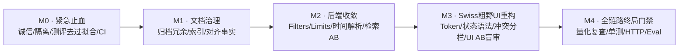

# Project Compass 逐条整改执行方案与 A/B 盲审协议（2026-11-14）

> 依据审计报告：[PROJECT_HEALTH_AUDIT_2026-11-14.md](./PROJECT_HEALTH_AUDIT_2026-11-14.md)
> 适用分支：`codex/evidence-links`（仅本地提交，不推送远端；零新增第三方运行时依赖）
> 用户已拍板方向：先做止血 + 过时文档直接归档；UI 视觉统一采用 **Swiss Bauhaus / Neo-Brutalism**；对不确定的技术/布局方案执行 **A/B 测试 + 多智能体内部盲审** 择优落地。

---

## 一、 整体收敛与重构阶段流

---

## 二、 逐条问题整改总表（R-01 至 R-26）

### 阶段 M0：紧急止血（产品诚信、隔离、测评可信度与基础 CI）

| 编号 | 审计分类 | 现状文件与定位 | 具体修改方案 | 可证伪验收标准 |
| :--- | :--- | :--- | :--- | :--- |
| **R-01** | 诚信红线 P0 | `web/app.js` L610, L623, L627, L1140 | 删除 6 处写死的 `"100% 绿灯"` 与内联绿标，收敛为共享 helper `renderSpeculativeBadge(item)` / `renderSpeculativeDetail(item)`：有 `evidence_ids` 时链接到对应证据并显示 `"✦ 关联校验通过"`，无证据时仅标 `"✦ 投机标记（缺直接测试证据）"` | 搜索 `app.js` 出现 `"100% 绿灯"` 为 0 次；渲染 DOM 中包含可点击 `data-evidence-id` |
| **R-02** | 样例隔离 P0 | `web_server.py` L331, L339；`cli.py` L307 | `--sample` / `sample_mode=True` 时 `dashboard_state()["projects"]` 固定返回 `[]`，`dashboard_state_for()` 直接拒绝，CLI 不把宿主机 `workspace_root` 传给样例服务器列表 | 新增 HTTP 测试 `test_sample_mode_never_exposes_host_registered_projects` 断言不泄露本机项目名 |
| **R-03** | 版本与清单 P0 | `plugin.json`, `server.json`, `web/index.html` | 三处版本号统一为 `1.0.0`；`server.json` 移除虚构 `"0.15s"` 及占位 URL `"your-org/ProjectCompass"` | `tests/test_plugin_manifest.py` 新增版本一致性与违禁占位符断言通过 |
| **R-04** | 测评去过拟合 | `eval/runners.py` L170-241；`literal_relevance.py` L8-16 | 回滚 `f5b84ec` 为迎合单语料金标准加入的 `"需要提供"/"需要核对"/"作为人工验收"/"端到端演练"/"手动提交"`、`[A-Z]\d{2,3}` 正则及题目特化停用词，恢复通用基线 | `git diff` 确认过拟合正则与停用词已清除，`ReferenceExtractor` docstring 与实现名实相符 |
| **R-05** | 测评口径修复 | `eval/runners.py` L170, L419；`l3_handoff.py` L44-108 | 修复 `ReferenceExtractor.name` 缺失导致报告误记 `batched`；修复 `default_runner()` 自相矛盾；`ProductAnswerer` 改为聚焦用户可见回答（取消倾倒 60 条任务+36 条假设）；`run_handoff()` 按 `investigate()` 实际证据顺位评分 | `BatchedExtractor(ReferenceExtractor()).name == "reference-rules-v1"`；L3 新增测试防止全量倾倒；重算真实 `baseline_report.json` |
| **R-06** | 测评完整可溯源 | `eval/__main__.py`, `eval/report.py`, `l1_structure.py`, `.github/workflows/ci.yml`, `pyproject.toml` | CLI 增加 `--extractor builtin|reference`；报告写入 `git_sha` 与 `gold_sha256`；0 冲突语料标明 vacuous pass；添加 GitHub Actions `ci.yml` 与 `[tool.ruff]` | `--extractor builtin` CLI 正常退出 0；`baseline_report.json` 包含溯源字段；`ci.yml` 语法合法 |

### 阶段 M1：文档治理与根目录收敛

| 编号 | 审计分类 | 现状文件与定位 | 具体修改方案 | 可证伪验收标准 |
| :--- | :--- | :--- | :--- | :--- |
| **R-07** | 文档累积混乱 | `docs/*_2026-*.md`, 营销/黑客松文档, `docs/superpowers/` | 在不触碰 `docs/ZETARIS_DEMO_CHALLENGE_55S.md` 的前提下，将一次性审查记录、营销探索稿与历史计划用 `git mv` 移入 `docs/archive/{reviews,hackathon_and_brand,superpowers}/` | 受保护文件 sha256 不变；`docs/` 顶层仅保留核心架构/产品/测评/指南文档 |
| **R-08** | 根目录残留 | `HACKATHON_BRIEF.md`, `SUBMISSION_CHECKLIST.md`, `PLAN.md`, `requirements-zetaris.txt` | 前三者 `git mv` 至 `docs/archive/root_legacy/`，删除已淘汰的 `requirements-zetaris.txt` | 根目录清爽；`tests/` 与包运行无任何断链 |
| **R-09** | 文档矛盾与失实 | `README.md`, `README_EN.md`, `PROGRESS.md`, `QUALITY_GATES.md`, `PRODUCT_FORM_AND_TECH_STACK.md` | 新建 `docs/INDEX.md` 索引；消除 5 处互相矛盾的硬编码测试数字，统一引用实时命令输出；更正 `PRODUCT_FORM_AND_TECH_STACK.md` 中虚构的 `events.jsonl` 为真实 JSON 原子快照架构；脚本验证 Markdown 链接零断链 | 链接检查脚本 0 error；核心文档不再声称互相矛盾的静态测试数 |

### 阶段 M2：后端代码收敛、分层解耦与检索 A/B 实验

| 编号 | 审计分类 | 现状文件与定位 | 具体修改方案 | 可证伪验收标准 |
| :--- | :--- | :--- | :--- | :--- |
| **R-10** | 魔数散落与常量同步 | `code_index.py`, `derived_context.py`, `candidate_extraction.py`, `eval/runners.py`, `eval/harness.py`, `literal_relevance.py` | 新建 `src/project_compass/limits.py` 统一管理长度上限、图谱节点边数阈值与 payload 上限，原模块重导出保持兼容 | 所有阈值单一真相源（SSOT）于 `limits.py` |
| **R-11** | 逻辑分叉与分层倒置 | `native_codex.py`, `candidate_extraction.py`, `dashboard.py:401` 等 9+ 处过滤与成员归属 | 新建 `src/project_compass/evidence_filters.py` 统一 `is_platform_control`、`SENSITIVE`、`resolve_member_id`、`is_public_raw_event`、`normalize_text`、`parse_iso_timestamp`（支持 `'Z'`）；修复 `dashboard.py:401` 漏查 `session_members` 的分叉 bug | `test_backend_convergence.py` 验证 `dashboard` 与 `projections` 成员归属完全一致 |
| **R-12** | Python 3.10 时间兼容性 | `models.py:62`, `dashboard.py:360`, `evidence_linking.py:286`, `project_scanner.py:56`, `project_workspace.py:83,96` | 全部替换为 `parse_iso_timestamp()` 统一处理 `'Z'` 后缀 | 正则扫描无裸 `datetime.fromisoformat(` 处理 `'Z'` 风险 |
| **R-13** | 并发写入临时文件踩踏 | `evidence_store.py`, `project_workspace.py` | 将固定 `.json.tmp` 改为 PID+线程唯一临时文件名后 `os.replace`，并补 `finally` 清理 | 多线程写入测试无冲突丢写或残留 `.tmp` |
| **R-14** | 大函数、复杂度与中文词表 | `investigator.py`, `fact_engine.py`, `cli.py`, `antigravity_adapter.py` | 新建 `intent_vocab.py` 收敛中文意图词表；拆分 `_investigate_claims`，消除双重 `derive_facts(events)` 与 O(S·F²) 冲突循环；`derive_facts(..., strict=False)` 支持坏 span 隔离；`cli.py` 暴露 `--index-code`；清理 `antigravity_adapter.py` 硬编码类名；严格维持 L4 调用链契约 | L4 `contract_chains.json` 全绿 15/15；新增 `derive_facts(strict=False)` 与 `--index-code` 单测通过 |
| **R-15** | 检索器演进不确定性 | `literal_relevance.py` | 运行 **A/B 实验 1（`run_workflow`）**：纯净 2-gram IDF vs 标准库内存 SQLite FTS5 Trigram BM25 长度归一化（无业务停用词），盲审后落地胜出方案并写入 `docs/RETRIEVAL_AB_TEST_AND_REVIEW_2026-11-14.md` | A/B 指标表 + 双盲审评分落盘；全量检索测试与 Eval 红线通过 |

### 阶段 M3：Swiss Neo-Brutalism UI 系统统一与 A/B 盲审重构

| 编号 | 审计分类 | 现状文件与定位 | 具体修改方案 | 可证伪验收标准 |
| :--- | :--- | :--- | :--- | :--- |
| **R-16** | 视觉语言分裂 | `web/styles.css`, `web/index.html` | 全面确立 **Swiss Bauhaus / Neo-Brutalism**：清除全部 11 处 `#0d6e52` 旧墨绿与全部 4 处大模糊软阴影，建立完整 `:root` token（含 spacing/radius/font-size/brutal-shadow），清除 `:root` 外野生 hex | CSS 检查 `#0d6e52 == 0`、blur soft-shadow == `0`、野生 hex ≈ `0` |
| **R-17** | 认知状态语法与文案一致性 | `web/app.js`, `web/styles.css` | 抽取单一 `renderStatusBadge(status)`：实线 `■ 已确认` / 虚线 `□ 待确认` / 朱砂双栏 `⑂ 冲突待裁决` / 琥珀 `◌ 待补证据` / 删除线 `× 已替代`，修复 `.accepted`/`.proposed` 视觉雷同与中英文混排混乱 | 审查 `app.js` 状态渲染唯一收敛，浏览器截图清晰可辨 4 种认知状态 |
| **R-18** | 信息架构与冲突裁决缺陷 | `web/index.html`, `web/app.js` | Team Truth 无 `accepted` 目标时诚实暴露缺口，不把 `proposed` 当已确认焦点头图；同主题冲突改为**左右并列分栏对照 + 底部裁决按钮**；通过 **A/B 实验 2（`run_workflow` + 真实浏览器截图 + 3 评委盲审）** 比较 Variant A（裁决优先账本）vs Variant B（瑞士非对称双栏网格），择优落地并达到 **≥ 9.0/10** Critic 评分 | A/B 报告 `docs/UI_AB_TEST_AND_REVIEW_2026-11-14.md` 落盘；最终 UI 独立 Critic ≥ 9.0/10 |
| **R-19** | 前端工程规范与测试兼容 | `web/app.js` | 抽齐 `apiFetch()`（全 15 接口带 `AbortController` 超时 + `encodeURIComponent` + 独立 `.error-state` 提示，消零空 `catch`）、`renderEmptyState()`、`renderErrorState()`、`renderEvidenceChip()`；严格保留 classic script 与 Node VM DOM 方法保护 | `node --check` 与 `node tests/web_tool_pair_test.cjs` 通过；空 `catch == 0`、裸 `fetch == 0` |
| **R-20** | WCAG AA 可访问性与移动端 | `web/styles.css`, `web/app.js` | 辅助文字加深至 `#475569`（≥ 7.5:1），行动橙按钮采用 `#C2410C` 白字或高对比 `#0F172A` 字（≥ 5.1:1），正文最小 `12px`；抽屉/弹窗加 `Esc` 关闭与焦点管理；按钮加 `aria-pressed` 与 `aria-live`；修复 390px 横滚条 | 自动化 CSS 字号与对比度核查 100% 达 AA；390px 截图无溢出 |
| **R-21** | UI 手册与代码脱节 | `docs/UI_STYLE_GUIDE_MANUAL.md` | 同步重写 Token 映射、Swiss 粗野边框阴影规则与认知状态语法表，保证文档与源码 100% 一致 | 手册中每个 CSS 变量与类名均可在 `styles.css` 找到 |

### 阶段 M4：终局全链路核查与收口交付

| 编号 | 审计分类 | 现状文件与定位 | 具体修改方案 | 可证伪验收标准 |
| :--- | :--- | :--- | :--- | :--- |
| **R-22~R-26** | 终局验证与交付物 | 全仓、`PROGRESS.md`, `HANDOFF.md`, `.goal/GOAL.md` | 执行前后端/CSS/JS 量化对比核查，重跑全套单测/Node/Eval，产出 `docs/HEALTH_REMEDIATION_FINAL_REPORT_2026-11-14.md` 并更新交接账本 | 全部门禁命令 exit 0；`git status` 仅余未触碰的 `docs/ZETARIS_DEMO_CHALLENGE_55S.md` |

---

## 三、 两场 A/B 实验与内部盲审设计契约

1. **实验隔离**：每场实验严格遵循“固定输入数据集与合同 + 单一变量 + 匿名标签随机映射 + 无上下文独立评委打分”。
2. **工作流编排工具**：均使用 `.gemini` 规定的 `run_workflow` Python 编排脚本落盘运行于对话 `scratch/` 目录，完整留存各变体产物、测试数据与盲审原始打分。
3. **不搞虚高指标**：若候选方案未能显著优于基线或破坏现有测试，果断保留或取其经过验证的独立亮点，严禁因汇报好看而降格门禁。
